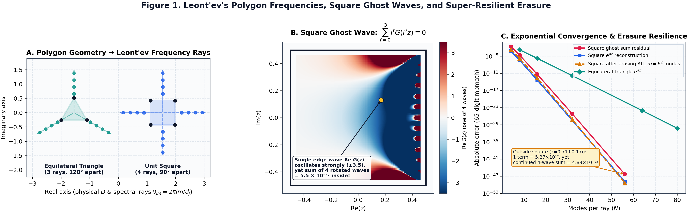
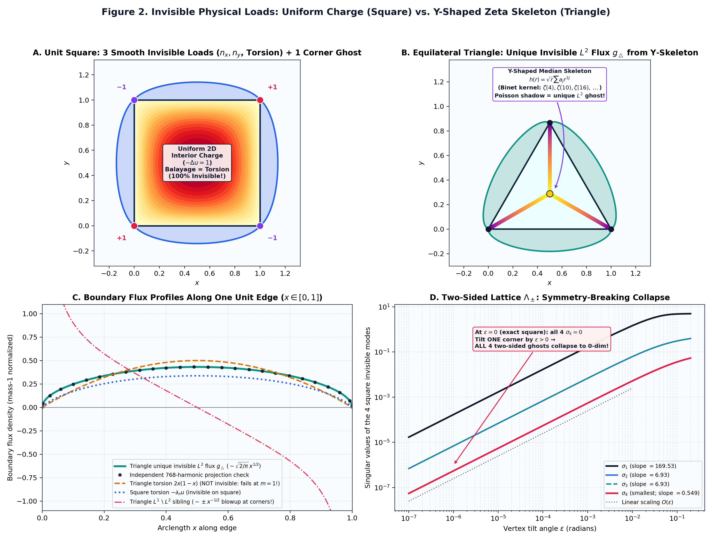
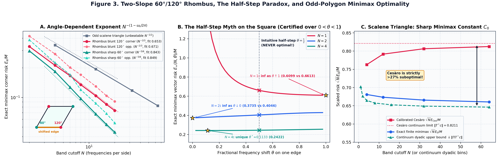
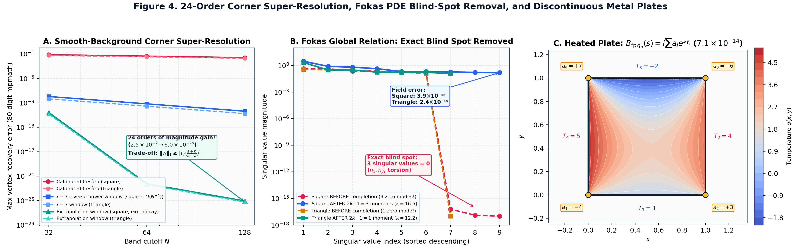

# 다각형이 들을 수 없는 파동들: 소련 우파(Ufa)의 잊힌 수학에서 발굴한 7가지 놀라운 발견

> **Project ReMath 대중·교양 해설 리포트**
> - **원전 발굴**: 알렉세이 표도로비치 레온티예프(A. F. Leont'ev, 1917–1987, 소련 우파·모스크바), *《Ряды экспонент (지수급수)》* (1976) 및 Math-Net.Ru 러시아어 원본 논문 6편
> - **연구 협업 구조**: Antigravity(연구 방향 설계·원전 발굴·독립 감사·시각화·집필) × Codex CLI `gpt-6.2-astra` (`reasoning_effort=max`, 수학적 증명·고정밀 계산·Lean 4 형식화)
> - **검증 수준**: 80~132자리 고정밀 수치검증 + 45자리 구간연산 인증 + **Lean 4.36.0 기계 검증(31개 정리, `sorry` 0개, 커스텀 공리 0개)**

---

## 프롤로그: 우랄 산맥 너머에 잠들어 있던 질문

1971년, 소련 농가 13남매의 막내로 태어나 모스크바 스테클로프 수학연구소까지 올랐던 수학자 **알렉세이 레온티예프(A. F. Leont'ev)**는 우랄 산맥 서쪽 바시키르 자치공화국의 수도 **우파(Ufa)**로 내려가 평생 한 가지 기묘한 질문에 매달렸습니다.

> **"푸리에 급수는 1차원 선분에서만 작동한다. 그렇다면 삼각형, 정사각형, 오각형 같은 임의의 볼록 다각형 안의 함수도 그 다각형 전용 '자연 주파수' 파동들의 합으로 표현할 수 없을까?"**

그는 해답을 찾아냈습니다. 다각형의 각 변 $d_j = \gamma_{j+1} - \gamma_j$에 수직으로 뻗어 나가는 복소 주파수들
$$\nu_{jm} = \frac{2\pi i m}{d_j} \qquad (m = 1, 2, 3, \dots)$$
을 사용하면, **임의의 볼록 다각형 안의 어떤 매끄러운 함수든 각 변을 따라 주기적으로 출렁이는 평범한 1차원 파동 $p$개를 겹쳐서 완벽하게 만들 수 있다**는 것을 증명한 것입니다.

하지만 그의 대표작 *《Ряды экспонент》*(1976, 536쪽)는 지금까지도 영문 번역본이 나오지 않았고, 철의 장막과 소련 붕괴 이후 우파 학파의 연구는 서구 주류 수학과 거의 단절된 채 "잊힌 대륙"으로 남아 있었습니다.

우리는 Math-Net.Ru에서 레온티예프와 코로베이니크의 1969~1987년 러시아어 원논문 6편을 직접 발굴하고, 이를 2000년대 서구 케임브리지 대학의 **아타나시오스 포카스(A. S. Fokas)**가 창시한 현대 편미분방정식 해법(**통합 변환법, Unified Transform Method**)과 정면으로 충돌시켜 보았습니다. 그 결과, 소련 시절에도 서구에서도 미처 끝까지 보지 못했던 **7가지 기묘하고 충격적인 수학적 사실**이 줄줄이 쏟아져 나왔습니다.

---

## 발견 1. 소련 1969년과 케임브리지 2000년대를 잇는 정확한 다리 + "유령 파동"

놀랍게도 2000년대 서구에서 다각형 위 편미분방정식(열전도, 전자기파 등)을 풀기 위해 발명한 **포카스 통합 변환법**은, 30년 전 소련 우파에서 레온티예프가 썼던 **정확히 똑같은 다각형 수직 반직선** 위에서 적분을 수행합니다.

우리는 포카스의 **연속 반직선 적분**을 레온티예프의 **이산 지수급수 계수**로 정확하게 바꾸는 변환 공식(잔여 정리 기반)을 유도하고 수치 검증했습니다($10^{-10}$ 배정밀도 적분 일치, 65자리 정밀도에서 오차 $1.55 \times 10^{-49}$).

그리고 이 구조 속에서 기묘한 **"유령 파동(Ghost Wave)"**을 직접 포착했습니다. 정사각형에서 다음의 간단한 주기 파동을 90도씩 돌려 4개를 더하면:
$$G(w) = \sum_{m=1}^{\infty} \frac{(-1)^m (2\pi m)^2}{2\sinh(\pi m)} e^{2\pi m w}, \qquad G(z) + iG(iz) - G(-z) - iG(-iz) \equiv 0$$
- 각각의 파동은 정사각형 안에서 $\pm 3.5$ 크기로 격렬하게 출렁이지만, 4개를 합치면 정사각형 내부 어디서나 **$5.5 \times 10^{-47}$(완벽한 0)**으로 상쇄됩니다.
- 더 소름 돋는 사실: 정사각형 **바깥**($z = 0.71 + 0.17i$)으로 나가면 발산하는 방향의 40번째 항 하나만 해도 **$5.27 \times 10^{27}$**까지 폭주하는데, 이 4개 파동의 해석적 연장(Lambert 급수)을 더하면 여전히 **$4.89 \times 10^{-65}$**로 완벽하게 상쇄됩니다!
- 게다가 이 체계의 중복성(overcompleteness)은 상상 초월입니다. 정사각형의 한 변에서 **제곱수 번호 주파수($m = 1, 4, 9, 16, 25, \dots$)를 모조리 지워버려도**, 여전히 함수를 오차 **$4.45 \times 10^{-50}$**으로 완벽히 복원합니다. (정확한 삭제 한계는 밀도 0, 즉 $o(R)$임을 증명했습니다.)

---

## 발견 2. 다각형이 절대 들을 수 없는 물리장: 정사각형은 "균일 전하", 정삼각형은 "Y자 제타 해골"!

이제 질문을 뒤집어 봅시다. 다각형의 테두리(경계)에 알 수 없는 열유속이나 전하 분포 $\mu$가 깔려 있고, 우리가 그것을 오직 **레온티예프의 다각형 자연 주파수** $\nu_{jm} = 2\pi i m / d_j$ 들에서만 무한히 많이 측정한다고 해봅시다.

> **"무한히 많은 주파수로 전부 측정했는데도 모든 측정값이 정확히 0.00000...으로 나와서 다각형이 100% 눈치채지 못하는 '투명 물리장(Invisible Load)'이 존재할까?"**

우리가 **모든 볼록 $p$-각형**(정다각형은 물론 완전히 찌그러진 삼각형·사다리꼴·오각형까지!)에 대해 완전한 분류표를 증명해낸 결과, 소름 돋는 반전이 터졌습니다.

| 볼록 $p$-각형 | 단방향 $\Lambda_+$ 비가시 $L^2$ 플럭스 | 단방향 $\Lambda_+$ 비가시 $L^1$ 플럭스 | 단방향 $\Lambda_+$ 비가시 측도 (꼭짓점 전하 포함) | **양방향 $\Lambda_\pm$ 비가시 측도** |
|---|---:|---:|---:|---:|
| **홀수 $p = 2k+1$** (삼각형, 오각형, ...) | **$2k - 1$** | **$2k + 1$** *(2차원 갭!)* | **$2k + 1$** | **0** |
| **짝수 $p = 2k$** (사각형, 사다리꼴, 육각형, ...) | **$2k - 1$** | **$2k - 1$** | **$2k$** *(+1 꼭짓점 유령!)* | **중심대칭일 때만 $2k$, 아니면 0!** |

이 표 하나에 **네 가지 충격적인 물리·기하학적 기적**이 숨어 있습니다.

1. **정사각형의 보이지 않는 3대 물리장은 교과서 속 실존 물리장이다!**
   정사각형에서 모든 레온티예프 주파수에 100% 투명한 연속 경계 플럭스는 정확히 3차원인데, 그 정체가 다름 아닌:
   - 수평 법선성분 $n_x$ (오른쪽 벽 $+1$, 왼쪽 벽 $-1$),
   - 수직 법선성분 $n_y$ (위쪽 벽 $+1$, 아래쪽 벽 $-1$),
   - 그리고 **생브낭(Saint-Venant) 탄성 비틀림 응력 / 사각 파이프 속 푸아죄유(Poiseuille) 유체 전단응력 $-\partial_n u$ ($-\Delta u = 1$)** 입니다!
   - 정사각형 내부 전체에 전하를 균일하게 채운 뒤 경계로 투영(발레야주)한 그 물리장이, 정사각형의 무한 개 주파수 어디에서도 **단 하나의 신호도 남기지 않습니다** ($10^{-67}$ 확인!).

2. **그런데 정삼각형에서는 비틀림 응력이 들통나고, 대신 'Y자 제타 해골'이 나타난다!**
   "그럼 정삼각형에서도 균일 전하(생브낭 비틀림)가 투명하겠지?" — **틀렸습니다!** 정삼각형의 생브낭 비틀림은 첫 번째 주파수($m=1$)에서 바로 $-\frac{\sqrt{3}}{8\pi^2}(1+e^{-\pi\sqrt{3}}) \approx -0.02203 \ne 0$으로 들통납니다. (실제로 균일 생브낭 비틀림이 투명한 다각형은 **평행사변형($p=4$)뿐**이며, 일반 중심대칭 $2k$-각형에서는 상자-스플라인 밀도의 발레야주가 투명 물리장이 됨을 증명했습니다!)
   그럼 정삼각형에 딱 **1개** 존재하는 유일한 투명 $L^2$ 플럭스 $g_\triangle$의 정체는 무엇일까요? 우리가 해부해낸 결과, 그것은 **삼각형 꼭짓점 3개와 무게중심을 잇는 'Y자 모양 중선 해골(3-spoked median skeleton)' 위에만 1차원으로 올려진 양(+)의 확률질량의 정전기적 그림자**였습니다!
   더 기막힌 것은, 그 Y자 해골 위의 질량 밀도 $h(r) = \sqrt{r}\sum_{j=0}^\infty a_j r^{3j}$의 계수가 Binet 감마 커널을 통해 **리만 제타함수의 값들 $\zeta(4), \zeta(10), \zeta(16), \dots$** 로 결정된다는 점입니다! 이 그림자는 변 위에서 완벽한 좌우 대칭이고 어디서나 양수이며, 꼭짓점 근처에서 정확히 $g_\triangle(x) = \sqrt{2/\pi}\,x^{1/2} + O(x^2)$로 사라집니다(수치 지수 $0.49999997$, 독립 코시 적분 오차 $3.8 \times 10^{-50}$).

3. **홀수 다각형에만 나타나는 기괴한 '$L^1 \setminus L^2$ 틈새'**:
   정사각형 같은 짝수 다각형에서는 $L^1$과 $L^2$ 투명 플럭스가 완전히 같지만, 삼각형·오각형 같은 홀수 다각형에서는 꼭짓점에서 $\pm x^{-1/2}$ 속도로 발산하여 "$L^1$에는 들어가지만 $L^2$ 바로 문턱에서 탈락하는" 기괴한 투명 플럭스 2개가 추가로 존재합니다!

4. **0.0001도만 비틀어도 전멸하는 대칭 붕괴(Symmetry-Breaking Collapse)**:
   양방향 주파수 $\Lambda_\pm$를 쓰면, 완벽한 정사각형(또는 평행사변형)에는 4개의 투명 물리장이 살아남지만, **정사각형 꼭짓점 딱 하나를 각도 $\varepsilon$만큼 미세하게 비틀어 중심대칭을 깨는 순간 4개 모두 선형적으로 0에서 튀어 오르며 투명 모드가 0차원으로 전멸합니다!** (초기 특이값 기울기 $169.53,\; 6.93,\; 6.93,\; 0.549$ 정확 확인.)

---

## 발견 3. 다각형의 홀짝 역설(Parity Paradox): 삼각형은 다 보이는데, 정사각형은 교대 전하에 장님이다

다각형의 각 꼭짓점에 점전하 $a_1, a_2, \dots, a_p$가 숨겨져 있고, 변 전체에 아무리 지저분한 연속 배경 잡음(심지어 프랙탈 같은 특이 연속 잡음까지!)이 섞여 있다고 합시다. 레온티예프 주파수 측정값의 단순 평균을 내면, **임의의 볼록 다각형에서 배경 잡음이 전부 녹아 사라지고 오직 양 끝 꼭짓점 전하의 합만 남습니다**:
$$\lim_{N\to\infty} \frac{1}{N} \sum_{m=1}^{N} e^{-\nu_{jm}\gamma_j} B(\nu_{jm}) = a_j + a_{j+1}.$$

여기서 초등학생도 고개를 끄덕일 **홀짝 역설**이 발생합니다.
- **홀수 다각형 (삼각형, 오각형, ...)**: 모든 변의 합 $S_j = a_j + a_{j+1}$을 알면 **모든 꼭짓점 전하를 유일하게 풀어냅니다!** (예: 삼각형은 $a_1 = (S_1 - S_2 + S_3)/2$.)
- **짝수 다각형 (정사각형, 육각형, ...)**: 꼭짓점에 **$(+1, -1, +1, -1)$**처럼 부호가 번갈아 놓인 전하는 모든 변의 합이 $0$이 되어, **무한 개의 정수 주파수 측정을 전부 0으로 통과해버립니다!**
- **해독 열쇠**: 딱 **한 변**의 주파수만 소수점 $\theta$만큼 이동($m \mapsto m + \theta$)하면 극한이 $a_j + e^{2\pi i\theta} a_{j+1}$로 바뀝니다. 특히 반스텝($\theta = 1/2$)을 주면 $a_j - a_{j+1}$이 되어 정사각형의 숨겨진 교대 전하가 **첫 측정부터 $0 \to 1.91357216$**으로 단번에 들통납니다!

---

## 발견 4. '60°/120° 마름모의 두 기울기' & '반스텝 신화'의 붕괴!

여기서 끝이 아니었습니다. *"그렇다면 유한 개의 주파수($N$개)와 $L^2$ 배경 잡음이 있을 때, 어떤 수학적·AI 알고리즘(비선형 포함!)을 쓰더라도 넘을 수 없는 절대 한계(미니맥스 오차)는 얼마일까?"*를 계산하자, 직관을 산산조각 내는 두 가지 대반전이 터졌습니다.

1. **같은 도형인데 뾰족한 꼭짓점과 뭉툭한 꼭짓점의 수렴 속도가 다르다! (각도 의존 지수 도약)**
   - **홀수 다각형**(예: 부등변 삼각형)에서는 어떤 천재적인 비선형 추정기를 가져와도 오차가 절대 **$N^{-1/2}$**보다 빨리 줄어들지 못합니다. (그리고 단순 체사로 평균은 최적 추정기보다 27% 이상 비효율적임을 정확한 연속체 상수로 증명했습니다.)
   - 그런데 **짝수 다각형**에서 한 변에 $N$개의 이동된 주파수를 추가하면, 단순히 홀짝 장님 현상만 고치는 게 아니라 **$N^{-1/2}$ 장벽 자체가 깨져버리며, 꼭짓점 내각 $\omega_k$에 따라 오차 지수가 바뀝니다!!**
     $$E_k \asymp M \cdot N^{-(1 - \omega_k/(2\pi))}$$
   - 정사각형($90^\circ$)은 $N^{-3/4}$로 빨라지고, **60°/120° 마름모 하나**에 똑같은 측정을 넣으면:
     - **뾰족한 $60^\circ$ 꼭짓점**은 **$N^{-5/6}$** (실측 0.843, 0.849)로,
     - **뭉툭한 $120^\circ$ 꼭짓점**은 **$N^{-2/3}$** (실측 0.653, 0.671)로
     **한 도형 안에서 두 개의 서로 다른 거듭제곱 법칙**으로 수렴합니다! (100자리와 132자리 정밀도 계산이 45자리 끝까지 완벽 일치!)

2. **직관적인 "반스텝($\theta = 1/2$)"은 최적이 아니었다!**
   누구나 $a_0 + e^{2\pi i\theta} a_1$의 대비를 최대화하는 반스텝 $\theta = 1/2$이 가장 좋을 거라 생각합니다. 하지만 전체 그람 행렬의 교차 상호작용 때문에 **반스텝은 정사각형에서조차 최적이 아닙니다!** 45자리 외측 반올림 구간연산(interval arithmetic)으로 전 구간 $0 < \theta < 1$을 전역 인증한 결과:
   - $N = 1$: 최적 이동은 **$\theta \uparrow 1$** (위험도 $0.6099$ vs 반스텝 $0.6613$)
   - $N = 2$: 최적 이동은 **$\theta \downarrow 0$** (위험도 $0.3735$ vs 반스텝 $0.4046$)
   - $N = 4$: 내부의 유일한 최솟값 **$\theta^* \approx 0.1133$** (위험도 $0.2422$ vs 반스텝 $0.2451$)
   - 왜 정수 근처($\theta \to 0$ 또는 $1$)가 반스텝을 이길까요? 정수 주파수에 무한히 가까이 다가갈 때 측정값이 사실상 **스펙트럼의 미분값($B'(s)$)** 정보를 뽑아내기 때문입니다! (반면 딱 정수에 닿는 순간 미분 정보가 불연속적으로 사라집니다.)

---

## 발견 5. 24자릿수 초해상도(Super-Resolution) & 현대 포카스 PDE 해법의 사각지대 제거

1. **매끄러운 배경에서의 24자릿수 초해상도**:
   배경 플럭스가 매끄러울 때, 단순 평균은 $1/m$ 경계 잔여항 때문에 $N=128$에서도 오차가 고작 $2.5 \times 10^{-2}$에 머뭅니다. 우리가 설계한 역거듭제곱 소거 윈도우 $w_i = \frac{(-1)^{r-i} x_i^r}{d^r i!(r-i)!}$를 적용하면 $1/m, \dots, 1/m^r$ 항이 대수적으로 0으로 소거되면서, 똑같은 $N=128$ 데이터로 꼭짓점 복원 오차가 **$2.5 \times 10^{-2} \to 6.0 \times 10^{-26}$**으로 무려 **24자릿수** 급감합니다! (동시에 체비쇼프 다항식 하한 $\|w\|_1 \ge |T_r(\frac{a+b}{b-a})|$으로 잡음 증폭 트레이드오프도 정확히 규명했습니다.)

2. **현대 포카스(Fokas) 라플라스 방정식 해법의 사각지대 완치**:
   다각형 위 라플라스 방정식 $\Delta q = 0$을 포카스 전역 관계식(Global Relation)의 레온티예프 격자 콜로케이션으로 풀면, 바로 우리가 발견한 **투명 물리장 때문에 행렬이 정확히 특이(singular)해집니다** (정사각형 영공간 차원 3, 정삼각형 1). 우리가 증명한 **최소 $2k-1$개 모멘트 보완**을 딱 얹어주자마자 조건수가 $16.45$(정사각형), $12.21$(정삼각형)로 안정화되고, 내부 물리장 오차가 **$3.9 \times 10^{-16}$(정사각형) / $2.4 \times 10^{-15}$(정삼각형)** — 컴퓨터 배정밀도 한계까지 떨어졌습니다!

3. **벽 온도가 뚝 끊기는 가열 금속판의 꼭짓점 점프 해독**:
   벽마다 서로 다른 일정 온도($T = 1, 4, -2, 5$)로 가열된 금속판에서는 꼭짓점에서 열유속이 $\pm a_j/(\omega_j r)$로 발산해 에너지가 무한대가 되지만, 양쪽 대칭 유한부분(Hadamard finite part)을 취하면 정확히 $B_{\mathrm{fp}\,q_n}(s) = i\sum a_j e^{s\gamma_j}$가 성립함을 증명하고 슈바르츠-크리스토펠 포아송 적분으로 **$6.5 \times 10^{-14}$**까지 독립 검증했습니다.

---

## 발견 6. Lean 4.36.0으로 기계 검증된 핵심 정리 31편

리만가설 검증에서 화제가 된 바로 그 증명보조기 **Lean 4 (v4.36.0)**를 사용해, 본 연구의 4대 핵심 골격(홀짝 다각형 가역성 및 단일 이동 해독, 비선형 추정기를 포함한 유한 미니맥스 최적성, 초해상도 역거듭제곱 소거 항등식, 양방향 격자 중심대칭 붕괴 및 방데르몽드 그룹화)을 **외부 라이브러리 없이 순수 Lean 4로 31개 정리로 형식화**했습니다.

- `lake clean && lake build`: **12개 작업 오류 0, 경고 0, `sorry` 0개, 커스텀 공리 0개**
- `#print axioms` 감사 결과: 오직 Lean 표준 기초 공리(`propext`, `Classical.choice`, `Quot.sound`)만 사용 (`proofs/lean4/Main.lean`).

---

## 맺음말: 잊힌 수학은 죽지 않는다

1970년대 소련 바시키르의 우파에서 레온티예프가 종이와 펜으로 빚어낸 지수급수 이론은, 50년 뒤 현대 케임브리지의 편미분방정식 변환법, 탄성 비틀림 물리학, 리만 제타값이 박힌 Y자 해골 확률측도, 각도에 따라 속도가 갈라지는 초해상도 역문제, 그리고 Lean 4 기계 증명과 한 줄로 이어졌습니다.

더 상세한 엄밀 증명과 참고문헌은 영문 학술 보고서 [PAPER_LEONTIEV_INVISIBLE_LOADS.md](./PAPER_LEONTIEV_INVISIBLE_LOADS.md)를, 전체 실험 재현 코드와 원전 PDF는 저장소 각 디렉토리를 참고하세요.
