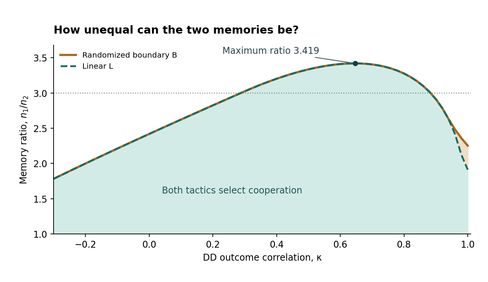

# The shock correlation that makes unequal memories cooperate

Take a strict Prisoner's Dilemma with $0<S\le1/2<P<R<T<1$. Both players use the linear tactic L or both use randomized boundary B. Each mixed profile has independent feedback. Fix the CC correlation arbitrarily and vary only the DD correlation. Set $h=\log(P/(1-P))$, $r=\log(R/(1-R))$, $\delta=2P-1$, and let the long-to-short memory ratio tend to $\gamma>1$.

Let $\underline V = \liminf_{n_2\to\infty} (-n_2^{-1}\log\Pr(\text{successful excursion}))$ be the lower limiting exponential cost per unit of short memory of a successful excursion from deep DD to CC (the ordinary limit $V$ exists at and near the optimum for both L and B, and globally for L, while part of the negative-correlation B rate remains bounded via $\underline V$). A strict upper limiting cost below $r$ selects cooperation, and a strict lower limiting cost above $r$ selects defection. [Full-game passage estimates](phase1_interface.md) · [Negative-shock estimates](phase1_negative_krylov.md)

**Theorem.** For both tactics, the smallest possible lower limiting cost $\underline V$ is $\gamma h$ (attained as a true limit $V=\gamma h$). Exactly one correlation attains it,
$$
                \kappa_*(\gamma)=\frac{1+1/\gamma}{2}.
$$
(For comparison, Dębicki–Ji–Rolski [arXiv:1906.09347, eq. (5) & Thm. 2.1] obtain $(1+\mu_1/\mu_2)/2$ as a threshold into a flat rate plateau for equal-capital unequal-drift Brownian ruin; in our unequal-memory action-changing Bernoulli game, $\kappa_*(\gamma)$ is a strict *unique* minimizer with positive quadratic curvature and an action-switching interface splitting at high correlation.) Consequently the supremum memory ratio permitting strict exponential cooperation is $\gamma_{\max}=r/h$. At $\gamma_{\max}$ the unique balancing correlation is $(1+h/r)/2$. This last point is an exponential tie.

**Proof.** Under the DD tilt $(h,0)$ the long deficit's mean step is $\delta$. The short deficit's mean is $\delta(2\kappa-1)$. The rare path by which the long player reaches its switching threshold therefore brings the shorter player to its own threshold on the same time scale precisely when $\gamma(2\kappa-1)=1$. At this correlation the straight tilted path realizes $\gamma h$. For the lower bound on the cost, the long player must make a first switch. Until that switch its outward probability is at most $1-P$, and B can also decline a switch. One-coordinate ruin gives the bound $\gamma h$, allowing polynomially many possible last departures.

Here are the strict inequalities. Write $M(s,t)$ for the DD moment function, with $s$ tilting the long coordinate. For $\kappa<1/2$, at $(h,0)$ the derivative $M_t$ is negative. A small positive second tilt is available. For negative correlations the two possible orders of last departures give a strict increment over $\gamma h$ by the negative-shock bounds. For $0\le\kappa<1/2$ the positive-tilt variational formula gives strictness directly. For $1/2\le\kappa<1$, write the regular DD boundary locally as $(s(t),t)$ through $(h,0)$. Then
$$
s'(0)=-(2\kappa-1),\qquad
\left.\frac{d}{dt}(\gamma s(t)+t)\right|_{t=0}=1-\gamma(2\kappa-1).
$$
Between $1/2$ and $\kappa_*$ a small positive $t$ increases the objective, with $s(t)\le h$ (also at $\kappa=1/2$ by strict concavity). Above $\kappa_*$ a small negative $t$ does so. On the latter side the mixed-profile constraint is strictly slack at $(h,0)$ because $T>P$ implies $T e^{-h}+(1-T)e^h<1$. The randomized-boundary return constraint has the same strict slack. At $\kappa=1$ the interface formula gives $h+(\gamma-1)s_I$ with $s_I>h$ for either tactic. These facts give strictness for every other admissible correlation.

**Width of the cooperation interval near its tip.** For either tactic the cost is smooth near $\kappa_*$ and
$$
 V(\gamma,\kappa)=\gamma h+
 \frac{2\gamma\delta}{(1-1/\gamma)(1+\delta^2/\gamma)}
 (\kappa-\kappa_*)^2+O(|\kappa-\kappa_*|^3).
$$
To verify this, put $w=2\kappa-1$. Under the $(h,0)$ tilt the signed steps $(U,V_2)$ satisfy $\mathbb E_*U=\delta$, $\mathbb E_* V_2=\delta w$. Conditional on $U$ the tilt preserves the original regression $\mathbb E[V_2\mid U]=\kappa U-\delta(1-\kappa)$. Hence
$$
D_2=\mathbb E_*[(V_2-wU)^2]=(1-w)(1+w\delta^2).
$$
Twice differentiating $M(s(t),t)=1$ gives $s''(0)=-D_2/\delta$. The active constraint near $\kappa_*$ is the smooth DD boundary on both sides. Indeed $\kappa_*>1/2$, its normal has both coordinates positive, and the mixed constraint has strict slack. The strictly concave objective along the boundary has expansion $\gamma h+(1-\gamma w)t-\gamma D_2 t^2/(2\delta)+O(t^3)$. Maximizing in $t$ proves the coefficient above. If $C_\gamma$ denotes that coefficient, the two local critical correlations at aspect ratios increasing to $r/h$ are
$$
 \kappa_\pm(\gamma)=\kappa_*(\gamma)
       \ \pm\sqrt{(r-\gamma h)/C_\gamma}+O(r-\gamma h).
$$

**A dilemma that defects at both extremes.** In the original unequal-memory example $(R,P,T,S)=(.8,.6,.9,.2)$, choose $\gamma=3$. Independent DD feedback gives cost $4\log(3/2)=1.6218604324\ldots$, above $r=\log4$. At the optimum $\kappa=2/3$ the cost is $3\log(3/2)=1.2163953243\ldots$, below $r$. Under perfect DD correlation it rises to $2.5570821561\ldots$ for L and $1.971979021289\ldots$ ($\approx 1.9719790213$) for B. Thus both tactics select DD at the two extremes and CC at the intermediate correlation. The CC law can remain independent throughout.

| DD correlation | Critical memory ratio for L | Critical memory ratio for B |
|---:|---:|---:|
| $-1/5$ | 2 | 2 |
| 0 | 2.41902258 | 2.41902258 |
| .20 | 2.82424377 | 2.82424377 |
| .50 | 3.33437827 | 3.33437827 |
| $(1+h/r)/2$ | 3.41902258 | 3.41902258 |
| .85 | 3.13573486 | 3.13573486 |
| .99 | 2.00273664 | 2.30400729 |
| 1 | 1.91171359 | 2.25224455 |

The finite-chain probabilities at memories $(120,40)$ hold the CC correlation fixed at zero.

| DD correlation | L stationary cooperation | B stationary cooperation |
|---:|---:|---:|
| 0 | $1.1243824689470\times10^{-6}$ | $1.2019409018877\times10^{-6}$ |
| $2/3$ | $.51784704403091$ | $.60502374190994$ |
| 1 | $4.6895728330092\times10^{-22}$ | $5.2111750650393\times10^{-12}$ |

The algebraic kernel calculations use 80 decimal digits. The local curvature is checked at correlation offsets down to $10^{-24}$. The independent full-chain stationary solve uses 72 decimal digits. [Calculation](../experiments/phase1_aspect.py) · [Full-precision data](../experiments/data/phase1_aspect.json)
