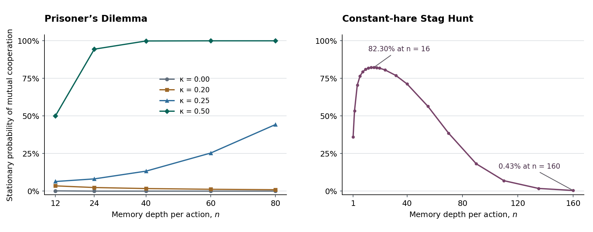

# Study 02 · Collective automata with correlated feedback

A strict Prisoner's Dilemma with payoffs $(R,P,T,S)=(.8,.7,.9,.2)$ has a unique dominant action, defection. At equal memory 80, two linear Tsetlin automata cooperate with stationary probability $1.249713582\times10^{-12}$ under independent feedback. Giving the symmetric profiles correlation $1/2$ raises that probability to $0.9999999705411542$ with all four payoffs unchanged. The limiting transition is sharp. A second game gives the opposite memory effect with independent feedback throughout. Joint stag hunting rises from 36.04% at depth 1 to 82.30% at depth 16, falls to 0.43% at depth 160, and tends to zero. [Numerical results for the dilemma](../experiments/data/phase1_shocks.json) · [Stag Hunt data](../experiments/data/phase1_reversal_curve.json)

## Conventions

All payoffs are win probabilities. Each time step uses a fresh outcome pair conditional on the current actions. The mixed profiles use independent feedback unless a different population law is specified. At symmetric profiles the two Pearson correlations may differ. In formulas about escape from DD, $\kappa$ means $\kappa_P$. The two private boundary coins of the B tactic are independent. The private Krylov coins are independent as well. Stationarity is taken at each finite memory before the memory limit. A probability per excursion starts at the deepest state and ends on the first positive return or the specified earlier target. The rate per excursion, a probability conditional on the eventual first exit, a mean passage time, and a mixing time require different normalizations. [Historical transition rules](phase1_architectures.md) · [Observable definitions](phase1_quadrant.md)

## 1. One payoff matrix, three architecture thresholds

For the strict dilemma $T>R>P>S$ with $P>1/2$, equal memories, and $0\le\kappa\le1$, write $p=P$, $q=1-p$. For each tactic the strict side $R>F$ selects CC, and $R<F$ selects DD.

| Tactic | Critical mutual-cooperation payoff $F$ |
|---|---|
| Tsetlin L, randomized boundary B | $(p^2+\kappa pq)/(p^2+q^2+2\kappa pq)$ |
| Krinsky D | $p+(1-\kappa)pq$ |
| Krylov K | $2p/(1+p^2+\kappa pq)$ |

For $0\le\kappa<1$, $F_L=F_B<F_D<F_K$ (where $D$ denotes the survey-$D$ boundary rule of Tsetlin 1963 §2, distinct from Krinsky's 1964 *Doklady* full-depth action redraw). At perfect common feedback $F_L=F_D=p$, while $F_K=2p/(1+p)$. A Krylov player independently discards half its penalties by turning them into steps deeper into the current action. This turns $p$ into $(1+p)/2$ and $\kappa$ into $\kappa p/(1+p)$ at a symmetric profile. The private randomization survives even perfect external correlation. For the motivating payoffs the L/B transition is at $13/63$, the survey-D transition is at $11/21$, and K selects DD throughout $[0,1]$. Remarkably, Volkonskii's own 1965 example $(R,P,T,S)=(.85,.65,.90,.60)$ at $\kappa=0$ already falls strictly inside the gap $(F_L, F_D) = (169/218, 351/400)$: survey-D selects DD ($\pi_{40}(CC)\approx 1.02\times 10^{-4}$), whereas linear L selects CC ($\pi_{40}(CC)\approx 0.99999991$), refuting the printed remark on p. 47 that linear automata behave analogously there. The survey-D formula extends to every feasible negative correlation and every strict PD, including zero-probability joint outcomes. On its transition line both CC and DD retain positive mass. [Architecture proofs](phase1_architectures.md) · [Degenerate Krinsky endpoints](phase1_anticorrelated_reset.md)

For the linear game's positive-correlation square, put
$$
J=\log\frac{P^2+\kappa P(1-P)}{(1-P)^2+\kappa P(1-P)},\qquad
h_x=\log\frac{x}{1-x}.
$$
For both L and B throughout $S\le1/2<P<R<T$ and at every fixed $0<\kappa<1$ (and for all-positive-drift L and B under $J < h_P + h_T - h_S$, which holds automatically along the strict-PD critical curve $J = h_R$),
$$
\frac{\pi_n(CC)}{\pi_n(DD)}
   =\Theta\!\left(n^{-1/2}\exp[n(h_R-J)]\right).
$$
For Krylov K, the exact same $\Theta(n^{-1/2}\exp[n(H_R^K - J_K)])$ law holds at every raw $0 < \kappa \le 1$ (including $\kappa = 1$, where effective correlation remains strictly below 1) under the effective direct-route condition $J_K < H_P^K + H_T^K - H_S^K$ (automatic along K's strict-PD critical curve $J_K = H_R^K$), using Krylov's transformed rates $H_x^K = \log\frac{1+x}{1-x}$ and $J_K = \log\frac{(1+P)^2 + \kappa P(1-P)}{(1-P)^2 + \kappa P(1-P)}$.
The interior critical point thus selects DD at a polynomial rate. For the independent motivating game the power is zero. Under deterministic L, equal memories, and synchronized feedback at **both** homogeneous profiles ($\kappa_R = \kappa_P = 1$), the synchronized linear pair reduces exactly to one birth–death chain (while if $\kappa_R < 1$, mixed profiles still retain positive stationary mass at finite $n$, and synchronized CC entered at unequal depths can still exit singly). At independence a strict dilemma with $P>1/2$ retains both pure masses at equality. Changing the CC shock correlation leaves the single-coordinate exit exponent $h_R$ unchanged. [Full-game transfer and mixing](phase1_square_prefactor.md) · [B and K extensions](phase1_architectures.md)

At $\kappa=.25$ the limiting linear phase is cooperation, although its stationary probability at depths 24, 40 and 80 is only .08144, .13302 and .44299. The corresponding odds after removal of both the exponential and the polynomial are .13256, .13425 and .13617. At $\kappa=0$ the same three rescaled odds are .064341, .064313 and .064313. These computations use nonnegative state elimination at 72 decimal digits. The old binary64 solver subtracted nearly equal entries in a nearly reducible chain. Its residual could be small even after the error in rare stationary masses became large. [Full-precision output](../experiments/data/phase1_shocks.json)

The single-flip cascade matters when a player in the mixed profile can remain entrenched. Under independent feedback and positive inward drift at every profile, define $a(x)=h_x$ for L/B, $-\log(1-x)$ for D and $\log((1+x)/(1-x))$ for K. The strict-PD odds exponent is
$$
a(R)-\min\{2a(P),\,a(P)+a(T)-a(S)\}.
$$
Since $a(P)>a(S)$ and $a(T)>a(R)$, the cascade cannot by itself select cooperation in a strict PD. In a Stag Hunt it can. The independent all-positive-drift tree costs, also covering Chicken, are
$$
W_{CC}=p+\min(t,p+s),\quad
W_{DD}=r+\min(s,r+t),\quad W_{\rm mixed}=r+p,
$$
where $(r,p,t,s)=(a(R),a(P),a(T),a(S))$ for the models covered in the independent-game note. A unique smallest cost selects the associated action class. For the linear Stag Hunt $(.78,.70,.72,.67)$ the cascade selects cooperation even though $h_R<2h_P$. The computed depth-40 probability exceeds .99925. Volkonskii already gave the independent all-positive stationary weights for L and D in §6, pp. 46–47, stating the full-chain constant-factor comparison without proof. [Independent-game derivation and hypotheses](phase1_social_game.md) · [Volkonskii (1965)](https://www.mathnet.ru/eng/ppi735)

The reward restriction on the hierarchy is material. In the independent strict dilemma $(.45,.20,.95,.10)$ (and under any full-support homogeneous shock law, excluding the singular synchronized case $\kappa_R=\kappa_P=1$ where L converges to $(6/7,0,0,1/7)$), survey-D and K both concentrate on cooperation, whereas L and B converge to $(0,3/14,3/14,4/7)$ in the order CC, CD, DC, DD. When $R<1/2$ there is a further boundary $T+S=1$. Above it one player stays close to maximum defection depth. On it the macroscopic depth of that player has a uniform limit on $[0,1]$. The other player keeps a finite depth. [Weak-reward theorem](phase1_weak_rewards.md)

## 2. The frozen corner and the action-changing game

Use loss-directed increments and let $a=q^2+\kappa pq$, $d=p^2+\kappa pq$, $b=pq(1-\kappa)$ at a homogeneous profile with reward $p>1/2$. Define
$$
M(s,t)=ae^{s+t}+2b\cosh(s-t)+de^{-s-t},\qquad
H(x,y)=\sup_{M(s,t)\le1}(sx+ty),\qquad h=\log(p/q).
$$
For the hard L boundary, let $m=\gamma n+O(1)$, $\gamma\ge1$. Lower-depth deficits reflect at zero. The event reaches $(m,n)$ before overflow of either upper coordinate or return to $(0,0)$. Its probability is $\Theta(n^\beta e^{-nE})$. For $-q/p<\kappa<1/2$ define
$$
\delta=p-q,\quad \lambda=1-2\kappa,\quad
v=\log\frac{1+\delta\lambda}{1-\delta\lambda},\quad
g=\frac{1+(1-\delta^2)\lambda-\lambda^2}{\lambda(1-\delta^2\lambda^2)} .
$$

| Condition | $E$ | $\beta$ |
|---|---|---:|
| $\kappa\ge1/2$ with $\kappa<1$, or $g>\gamma$ | $H(\gamma,1)$ | $-1/2$ |
| $0<g\le\gamma$ | $\gamma h+v$ | $0$ |
| $g=0$ | $\gamma h+v$ | $-1/2$ |
| $g<0$ | $\gamma h+H(0,1)$ | $-3/2$ |

The first route has positive velocity in both coordinates. In the second the walk first advances on an axis. In the last the terminal passage must avoid a ceiling while its long-coordinate mean displacement is zero. A one-dimensional ballot factor, valid even conditional on the other endpoint, accounts for the extra power. At equal memory, positive correlation gives $E=\log(d/a)$, while negative correlation always selects a wall route. At $\kappa=-q/p$ the hard corner is unreachable. At $\kappa=1$ it is reachable only for equal barriers. For $\kappa=0$ an exact leading constant, valid at every fixed aspect ratio, is
$$
\Pr(\text{corner per excursion})\sim
\frac{(1-q/p)^2}{\sum_{j\ge0}\mathrm{Cat}_j^2(pq)^{2j}}\,(q/p)^{m+n}.
$$
Here $\mathrm{Cat}_j$ is the $j$th Catalan number. Shifting both barriers by one gives the automata's literal preflip states. If visits to the deep origin are allowed before the *first* possible overflow, renewal divides the per-excursion success probability by the probability of a terminal excursion. This subtracts $h$ from the equal-memory exponential cost for the interior hard model. [Proof, algebraic formula for $H$, normalization and numerical enclosures](phase1_quadrant.md)

B can decline an action switch at its shallow boundary. Under perfectly common shocks and unequal barriers, its unflipped corner is reachable, with
$$
\Pr(\text{B corner per excursion})\sim
(p-q)(q/p)^m\,2^{-(m-n)}.
$$
For large positive correlation the soft boundary can also change the interior rate before perfect synchrony. The frozen B analysis identifies the supporting short-coordinate tilt $-\log2$ at which this happens. For $p=7/10$, $\kappa=181/189$ the critical aspect ratio is exactly $46/25$. For $p<1/2$ the hard L walk has $E=H(\gamma,1)$ and power $-1/2$ for nonsynchronous shocks. At $p=1/2$ with interior correlation it has zero exponential rate. [Randomized boundary](phase1_random_boundary.md)

At fair independent rewards the rate zero conceals both a logarithm and a classical elliptic integral. For equal barriers, the hard corner probability per excursion is asymptotic to $\Gamma(1/4)^4/[128(4-\pi)n^2\log n]$. For B the coefficient is $5\Gamma(1/4)^4/[128(4\log3-\pi)]$, about 3.426 times larger. On a rectangle the corresponding shape factor is $4kk'K(k)^2/\pi$, where $K(k')/K(k)=\gamma$. A two-state Green function supplies the logarithm through recurrent visits to the origin. [Proof, leading constants and numerical checks](phase1_fair_corner.md)

The full action-changing game can follow an additional route. Suppose $S<1/2<P<R<T$. At independent outcomes the strict critical memory ratio for L is $\gamma_c=h_R/h_P-1$ whenever it lies at or above one. With positive correlation the full rate is specified by the moment functions of both DD and the mixed profile. At high correlation and a sufficiently long first memory, an optimum can repeatedly cross the short player's switching edge. For $P=.51,T=.55,S=.20,\kappa_P=.997,\gamma=2$, the following rates have distinct consequences.

| Event | Cost per unit of short memory |
|---|---:|
| Stationary frozen deficits exceed both thresholds | .0800106692273983 |
| Full linear game reaches cooperation before returning to deep DD | .0858137634645092 |
| Frozen linear profile reaches the preflip corner | .2875095168611353 |

At $R=.53$ the full game cooperates. At $R=.5206$ it defects. The two frozen comparisons each predict the wrong outcome for one of those games. At $(R,P,T,S)=(.78,.6,.9,.2)$, $\kappa_P=.99$ and $\gamma=2$, randomizing the shallow switch changes the selected profile. The linear cost 1.38348782 exceeds $h_R=1.26566637$, while the B cost 1.15386228 falls below it. The finite-grid committor also agrees with the interface calculation in a separate example through depth 80. For negative correlation the two ordered last departures from the deep axes give a sharp test of strict cooperative selection. With $(.8,.6,.9,.2)$ and $\kappa_P=-1/5$ it yields $\gamma_c=2$ exactly, compared with $2.4190\ldots$ at independence. [Full-game positive-correlation and interface formulas](phase1_interface.md) · [Negative-correlation tests](phase1_negative_krylov.md)

For $S\le1/2<P<R<T$ and any $\gamma>1$, both L and B achieve their least possible lower limiting cooperation-passage cost $\underline V = \liminf -n_2^{-1}\log\Pr(\text{successful excursion}) = \gamma h_P$ (with the ordinary limit existing at and near the optimum, and globally for L) at the unique DD correlation $\kappa_*=(1+1/\gamma)/2$ (contrasting with the Brownian equal-capital plateau of Dębicki–Ji–Rolski 2019). With $(.8,.6,.9,.2)$ and $\gamma=3$, independent and perfectly common shocks both select DD, while $\kappa=2/3$ selects CC. At depths $(120,40)$ with CC correlation held fixed at $\kappa_R=0$, the linear pair's stationary probabilities are $1.12438\times10^{-6}$, $.517847$ and $4.68957\times10^{-22}$ at DD correlations $0$, $2/3$ and $1$ (and setting $\kappa_R = \kappa_P = 2/3$ gives $.563799$ for L and $.616779$ for B). The supremum of the aspect ratios admitting a strictly cooperative phase is $h_R/h_P$. The correlation window closes with a square-root law at this exponential tie. [Proof of the optimal correlation and phase diagram](phase1_optimal_correlation.md)

The worst-case mixing time depends on which well carries stationary mass. In the motivating independent dilemma, mean time to cooperation from deep DD has order $(7/3)^{2n}$. Total-variation mixing takes order $4^n$. Increasing DD correlation in the defection phase first accelerates the rare passage while leaving the mixing exponent unchanged. Under fully common symmetric shocks the linear chain admits an exact asymptotic mixing profile, leading constant and spectral gap. The infinite-capacity reflected joint tail also has explicit leading constants and distinct crossover windows at independence and synchrony. [Full-game mixing comparison](phase1_square_prefactor.md) · [Spectral and joint-tail calculations](phase1_mixing.md)

## 3. A finite optimum and a false equality optimum

In the constant-hare Stag Hunt take $P=T>1/2$, $0<S<P<R$. Put $\rho_x=(1-x)/x$ and $G_n=\sum_{j=0}^{n-1}(S/(1-S))^j$. The stationary linear odds satisfy
$$
\frac{\pi_n(CC)}{1-\pi_n(CC)}
  =\Theta\!\left(G_n(\rho_P^2/\rho_R)^n\right).
$$
For $1/2\le S<P$, the odds have the stronger equivalent $K G_n(\rho_P^2/\rho_R)^n$, where $K=(2P-1)^2/[(1-S)(2R-1)]$. With a fair solo stag, $G_n=n$. Every fixed subcritical game loses cooperation as memory tends to infinity. As $R$ approaches $R_c=P^2/(P^2+(1-P)^2)$ from below, the maximum finite cooperation probability tends to one. Every maximizing depth satisfies $n_*\,|\log(\rho_P^2/\rho_R)|\to1$ in that limit. For the figure, $R=15/16$, $P=T=4/5$, $S=1/2$ and $\rho_P^2/\rho_R=15/16$. The reversal also occurs with a biased solo hunt. With $(.94,.8,.8,.45)$ the depth-12 value exceeds .737 and the limit is zero. In the old StagHunt-2 example the exponential ratio is $19/16>1$ and cooperation tends to one. Integer determinant certificates give $\pi_1(CC)=3328/9233$ and $\pi_2(CC)=58905001984/110489411359$ in the illustrated game. Its exact worst-start mixing times at tolerance one quarter are 5 and 67 rounds at those depths. General small-depth formulas accompany the proof. [Stag Hunt theorem, small depths and mixing](phase1_reversal.md)

For the variable-memory PD $(.8,.6,.9,.2)$ at independent outcomes, the omitted integer between 10 and 12 changes the local conclusion.

| $(n_1,n_2)$ | Stationary CC | Player 1 payoff |
|---|---:|---:|
| $(10,10)$ | .720608517331598 | .743962571531404 |
| $(11,10)$ | .731673697006678 | .746391275680356 |
| $(12,10)$ | .677011848788834 | .735637981028833 |
| $n_1\to\infty$, $n_2=10$ | 0 | $435941/724450=.6017544344\ldots$ |

There are strict cooperating dilemmas in which every sufficiently large equal pair admits a profitable unilateral upgrade, and Chicken examples in which a sufficiently large upgrade reduces the buyer's payoff. In one explicit anonymous public good, one long memory can change unanimous cooperation into unanimous defection. With one signal shared by each action group, benefit $h$ to the other players in total, and private gain $d$ from defection, the exact boundary is $d=h(N-2)/(N-1)$. Above it the whole population defects in the iterated limit, first the tagged memory to infinity and then peer memory to infinity. Below it the $N-1$ peers continue to cooperate. At equality those peers collectively cooperate half the time. [Memory incentives, limiting order and outcome law](phase1_memory.md)

## 4. Partial common funds

In two independent dilemmas with $T+S=2P$ the all-cooperate Nash threshold is $1/3$. For $(.8,.6,.9,.3)$ the linear automata already cooperate at zero redistribution. For $(.8,.7,.85,.55)$ they need redistribution above $0.6260592763905164\ldots$. The large-depth threshold is the root of a quadratic. For the original fund probe $(.8,.7,.95,.35)$ the two thresholds are $.50$ and $.797191385916507$. The comparison uses the existence of an all-cooperate Nash equilibrium. Weak dominance and finite-depth stationary balance have separate thresholds. [Closed-form fund calculation](phase1_fund_boundary.md)

A population result with fixed, strictly interior probabilities gives a persistent absolute welfare gain. Each volunteer pays .60. Meeting a quorum of one quarter raises the common base win probability from .80 to .97. With independent L or B automata of depth one, the limiting welfare at pooling fractions $0,\ 2/3,\ 1$ is respectively $.68,\ .79,\ .67$. The optimal stationary welfare tends to $.82$ and every maximizing fraction tends to $3/5$. In this game both the optimal welfare gap and the positive excess of the maximizing fraction over $3/5$ have order $\sqrt{\log N/N}$. At exactly $3/5$ the welfare gap instead has order $1/\log N$. At this fraction defection is strictly dominant. A pivotal contributor at a quorum can sustain a pure Nash equilibrium only once the fund reaches $43N/[60(N-1)]$. In the related single-volunteer good, half pooling has an exact welfare-deficit order $\Theta(\log N/\sqrt N)$ under the specified success law. Introducing a fixed failure probability for free riders changes the optimum in that second model. [Population proofs, exact witnesses and noise assumptions](phase1_pooling.md)

For the historical placement probe, the Nash allocation has six players on the rich site and six on distinct small sites. Its mean raw welfare is $19/120$, and the optimum is $53/240$. Repeated simulations at depth 12 show an improvement of about .0055 in mean raw welfare over the better endpoint. In the grid tested, .85 outperformed .50. The placement effect is modest, and the Monte Carlo result has finite-run uncertainty. Pittel's theorem uses a single shared signal and a particular feedback curve. The independent signals in this placement simulation require their own analysis. [Placement replications and historical assumptions](phase1_pooling.md) · [Pittel (1965)](https://www.mathnet.ru/eng/ppi752)

## Publication and formalization priorities

1. **Architecture, correlation, and critical selection.** A shared payoff matrix gives two distinct exact critical correlations and no transition for the third architecture. Formalize the two-point Fréchet law, private Krylov thinning, threshold nesting and exact rational counterexamples first.
2. **Unequal memories have an optimal shock correlation.** Its value depends only on the ratio of memory depths. The frozen ceiling supplies a ballot factor, and the action-changing interface yields a different macroscopic exponent. The kernel root identities, exact phase certificates and conditional ballot identity are suitable finite Lean targets. The probability estimates need a separate formalization.
3. **Near-unanimous cooperation at finite memory followed by collapse.** Constant hare is an ordinary Stag Hunt. The reference product law gives an exact entrance flux and explains the factor $n$ at a fair solo hunt. The flux identity, detailed balance and determinant witnesses provide a compact formal core.
4. **An optimal common fund below the pivotal Nash threshold.** The quorum population gives a fixed positive absolute welfare gain and a rational limiting optimum. Formalize the binomial mean drift, drift signs and welfare upper bound. The stationary concentration arguments can be refereed independently.

## What remains open

A zero exponential odds slope can give coexistence, polynomial loss of cooperation, or concentration, depending on the game. The positive-correlation stationary-odds estimate for the motivating game gives the exact power and bounded multiplicative factors. A limiting constant in that estimate, the frozen power at $p=1/2$ for nonzero interior correlations, and part of the unequal-memory B passage exponent on the negative-correlation defection side remain open. The full separation curve for $P<1/2<R$ with $T+S>1$, the unequal-memory game with general $S>1/2$, and arbitrary heterogeneous populations with independent signals also remain open. The N=12 placement results are simulations. The large-population proof uses the specified public good. The project has mathematical derivations and computational certificates for this phase. Lean verification and a comprehensive historical priority audit belong to later phases. Nearby antecedents include stationary quadrant tails, first passage to a remote orthant, and later auxiliary-chain work on automata and common-fund games. [Gurvich (1975)](https://www.mathnet.ru/eng/at7793) · [Kobayashi and Miyazawa](https://arxiv.org/abs/1201.3167) · [Pan and Borovkov](https://arxiv.org/abs/1708.09605)

The study index gives the verification commands. [Study and reproduction guide](../STUDY.md)
