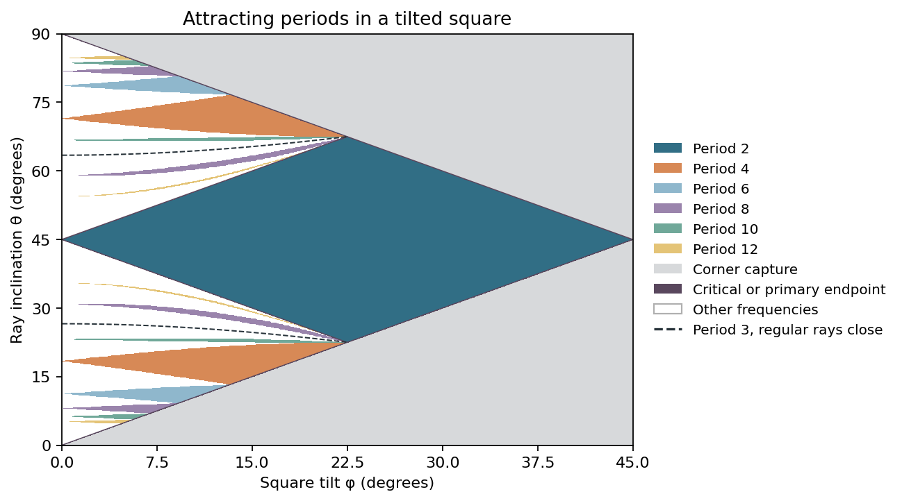
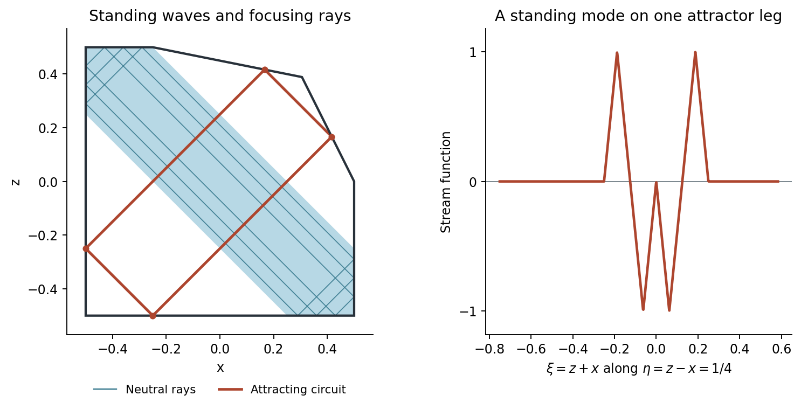

# Standing modes and attracting rays in polygonal tanks

Phase 1 mathematical scouting report, Study 03 · 24 November 2026

**The strongest result is a construction at a single frequency.** Choose a neutral threshold \(a\), normalized half-heights \(0<r_1<\cdots<r_m<a<1\), and contraction factors \(0<\kappa_i<1\). A convex polygon with \(m+5\) sides realizes them as four-bounce attracting circuits while retaining a prescribed infinite-dimensional Dirichlet eigenspace. The number of sides is sharp for period two with a neutral beam. A six-sided tank already exhibits the effect. Every nonzero standing mode is visible on its attracting circuit.

The tilted rectangle gives a different answer. Work at reduced tilt \(0<\phi<\pi/4\), exchanging the two body axes and replacing the aspect ratio \(R\) by \(1/R\) for a larger acute tilt. At each such tilt almost every frequency produces a periodic attractor or a corner attractor. At \(\phi=45^\circ\) the open supercritical window is empty and the characteristic angle \(\theta=45^\circ\) has zero Dirichlet kernel. Depending on the tilt and aspect ratio, the same tank can have countably infinitely many eigenfrequencies or none. For a square the change occurs at \(22.5^\circ\). The primary square tongue and its saturation at this angle were known before this study. The aspect-ratio criterion, the fixed-tank measure proof, and the distinction between the two spectra matter here. [Kopecz, Theorem 2](https://webspace.science.uu.nl/~maas0131/files/kopecz2006.pdf) · [Bajars, Frank & Maas, §2.4](https://webspace.science.uu.nl/~frank011/Articles/BaFrMa12.pdf)

| Frontier | Proved in Phase 1 | Additional hypothesis or question | Verdict |
|---|---|---|---|
| Tilted rectangles | Every attained rational has an exact parity classification. The regular-attractor frequency measure is \(\cos\phi-\sin\phi\) for \(0<\phi<\pi/4\). | Rational body-coordinate slopes characterize standing waves. | **Disproved in both directions** |
| Finite-energy modes | The boundary criterion covers weak solutions, vertices and characteristic faces. It gives the triangle and diamond cases and characterizes the unique all-frequency attractor-free convex polygon. | Global periodicity of a midpoint-extended map at a characteristic edge suffices for a mode. | **Disproved at periods two and three** |
| Coexistence | Exact modes coexist with prescribed circuits. The general maximum of regular attracting cycles on \(k\) sides is \(k-3\). | A coexisting circuit can miss a nonzero mode spatially or capture every exterior launch. | **Both possibilities disproved** |
| Circle limit | The corner measure, resonant families, a growing-period measure bound and a quantitative quasimode follow from polygon geometry. | What is the all-period regular-attractor measure outside the corner intervals for arbitrary regular polygons, and its limit as \(N\to\infty\)? | **Open** |

## Frequency, section and measure conventions

For the operator in the question, substitution of \(u=f(z+sx)\) into the stationary equation gives \((1-\lambda^2-\lambda^2s^2)f''=0\). Thus
\[
 s=\tan\theta=\frac{\sqrt{1-\lambda^2}}{\lambda},\qquad
 \lambda=\cos\theta,\qquad P\text{ has spectral parameter }E=\lambda^2 .
\]
The question's \(c=\lambda/\sqrt{1-\lambda^2}\) is the horizontal displacement per unit vertical displacement. Using it in \(z\pm cx\) exchanges \(E\) with \(1-E\). All angular formulas below use the inclination of the ray to the horizontal. Length in \(\lambda\) refers to physical frequency. The assertions about almost every frequency concern Lebesgue measure. A pure-point operator can have a countable dense set of eigenvalues of Lebesgue measure zero.

The standing streamfunctions \(u\) are eigenvectors of \(T=\Delta_D^{-1}\partial_z^2\) on \(H_0^1(\Omega)\). The operator \(P=\partial_z^2\Delta_D^{-1}\) acts on \(H^{-1}(\Omega)\), with \(P\Delta_D=\Delta_D T\). Thus its corresponding eigenvector is \(\Delta_Du\).

Write \(\xi=z+sx,\ \eta=z-sx\). One iteration of \(b=\gamma^+\gamma^-\) comprises two chords, first of slope \(+s\). The tables in this report use **clockwise** boundary rotation \(p/q\). The computational edge coordinate runs counterclockwise, so its label is \(1-p/q\). The denominator agrees. A per-circuit multiplier \(M\) gives exponent \(\log M/q\) per iteration of \(b\). A regular cycle meets only open, transverse edges. A transverse common supporting vertex attracts from one side and repels from the other. An edge parallel to a ray requires a separate boundary condition.

## 1. Tilted rectangles

Set
\[
 a=\tan(\theta-\phi)/R,\qquad b_1=\tan(\theta+\phi)/R,\quad
 \mu=b_1/a,\quad \ell=\frac a{a+b_1},\quad t=\frac{a b_1}{a+b_1}.
\]
In the open supercritical interval \(\phi<\theta<\pi/2-\phi\), unfold reflections in the body coordinates to a northeast flow of alternating slopes \(a,b_1\) on a unit checkerboard. Quotient by integer translations of even coordinate sum. Crossing one column gives the circle map \(t+K_\ell\), up to conjugation, where the increasing lift of \(K_\ell\) interpolates \((0,\ell),(\ell,1),(1,1+\ell)\). The slopes are \(\mu,\mu^{-1}\), with \(\mu=(\sin2\theta+\sin2\phi)/(\sin2\theta-\sin2\phi)\).

There is also an explicit map on the whole boundary. In rescaled body coordinates \((X,Y)\), measure \(w\) counterclockwise from \((1,0)\) by accumulated \(|d(Y-aX)|\), and \(H(w)\) by accumulated \(|d(Y+b_1X)|\) from the same point. The increasing lift \(H\) has successive slopes \(1,\mu,1,\mu\) on the four walls. The extrema of the first projection occur at \(w=0,1+a\), those of the second at \(H=1,2+b_1\). The chord pair therefore acts as
\[
 B(w)=H^{-1}\bigl(2-H(-w)\bigr)\pmod{2(1+a)} .
\]
Its branch slopes belong to \(\{1,\mu,\mu^{-1}\}\). Some branches can have zero length.

For primitive unfolded vertical/horizontal winding \(n/m\), the clockwise boundary label is \(n/(m+n)\). The quotient-section lift has rotation \((m+n)/(2m)\). Its reduced denominator and the denominator of the boundary rotation therefore have opposite parity. On the section, the two branches are reciprocal, and the section is reversed by a reflection. If a regular orbit and its reversal are distinct, the two orbits interlace and their symmetry bounds the difference in visits to the two semicircles by one. A regular orbit can also equal its own reversal. Its points then occur in pairs, with one point of each pair in each semicircle. The counts coincide for even section period. The periodic-break cases give global finite order for even section period and a one-sided cycle at a tongue endpoint for odd section period. The two-break theorem and the unfolding give the following boundary law. [Rectangle derivation and finite endpoint formulas](phase1_rectangle.md) · [Checkerboard proof](phase1_parity.md) · [Lenci, Bonanno & Cristadoro, Proposition 3.1](https://arxiv.org/abs/2102.01654)

| Reduced clockwise boundary rotation | Dynamics at this fixed tank | Finite-energy modes |
|---|---|---|
| \(q\) even, tongue interior | Regular attracting and repelling circuits, multipliers \(\mu^{-2},\mu^2\). Attracting exponent \(-2\log\mu/q\) | Zero |
| \(q\) even, an interior-window endpoint of a tongue | Periodic connection through a vertex, one-sided dynamics | Zero |
| \(q\) odd | At a single angle, \(b^q=\mathrm{Id}\) everywhere | Infinite multiplicity |
| Irrational | No periodic ray, continuous invariant boundary profiles are constant | Zero |

Every label in the attainable range follows this table. Put \(L=\lceil R\cot(2\phi)\rceil\), \(U=\lceil\cot(2\phi)/R\rceil\). The supercritical **clockwise** rotation range is \([1/(2L),\,1-1/(2U)]\). Endpoint labels are realized on intervals adjoining the critical angles. In particular, a fixed tank need not realize every rational between zero and one. Neutral beams and regular attracting cycles cannot coexist in a parallelogram of this family.

Some exact boundaries and centers are short. Conditions in the table are restricted to the open supercritical window. The parameter \(b_1\) below is a positive slope.

| Clockwise label | Algebraic condition |
|---|---|
| \(1/2\) | \(a\le1\le b_1\), equivalently \(\lvert\theta-\arctan R\rvert\le\phi\) |
| \(1/(2j+2)\), \(j\ge0\) | \((j+1)a+j b_1\le1\le j a+(j+1)b_1\) |
| \(1/(2j+1)\), \(j\ge1\) | \(j(a+b_1)=1\) |
| \(2/5\) | \(a^2+a b_1+b_1^2=a+b_1\) |

Reciprocal windings follow by swapping \(a,b_1\) with \(1/b_1,1/a\). Arbitrary labels have the finite floor-and-product endpoint formula in the rectangle derivation. At tongue endpoints and isolated neutral angles, \(\tan\theta\) satisfies an algebraic equation with coefficients in \(\mathbb Q(R,\tan\phi)\). The itinerary inequalities select its root. An interior rational label with even denominator selects an open tongue, as the \(1/2\) row illustrates. Each attained odd-denominator label occurs at a single angle, as in the \(1/3\) row. An exact algebraic specification accommodates higher degrees without assuming radicals exist.

| \(15^\circ\)-tilted unit square, clockwise | Horizontal angle | Frequency \(\lambda\) | Outcome |
|---|---:|---:|---|
| \(1/4\) | \(15^\circ<\theta<22.013961572643^\circ\) | Upper-angle endpoint \(0.927092544625\) | Four-step attractor |
| \(1/3\) | \(24.675774588338^\circ\) | \(0.908684776027\) | Global neutral beam |
| \(2/5\) | \(28.566423689213^\circ\) | \(0.878263346305\) | Global neutral beam |
| \(1/2\) | \(30^\circ<\theta<60^\circ\) | At center \(1/\sqrt2\) | Center multiplier \(1/9\), exponent \(-\log3\) |

For period two the plot tests the integer angle equalities and inequalities directly, marking critical directions and primary endpoints separately. For periods four through twelve it checks both strict algebraic endpoint inequalities with outward intervals before coloring a sample. Almost every point in the white supercritical region belongs to a higher-period tongue.

**Measure at every fixed tilt.** Corner capture occupies angular length \(2\phi\) and frequency length \(1-\cos\phi+\sin\phi\). Regular periodic attractors occupy angular length \(\pi/2-2\phi\) and frequency length \(\cos\phi-\sin\phi\). Thus the combined frequency measure equals 1 for every \(0<\phi<\pi/4\), and equals 0 for \(\phi=0\). In particular the periodic part alone approaches 1 as the tilt tends to zero. The critical frequencies and endpoints of tongues have zero measure. Assigning a corner mass at either critical endpoint has no effect on these formulas.

The quantifier “every fixed tilt” needs an additional proof. In the two-break model put \(v=\tfrac12\log(b_1/a)>0,\ x=\sqrt{a b_1},\ L_0=2\cosh v\). Translation \(x\mapsto x+L_0\), sign reversal, and interchange of the checkerboard axes preserve regular hyperbolicity. The elementary hyperbolic gap is \(e^{-v}<|x|<e^v\). Repeated nearest translations and inversions put every exceptional parameter on a finite or infinite continued-fraction branch with maps \(y\mapsto-1/(jL_0+y),\ j\ne0\). On \([-e^{-v},e^{-v}]\) these are contractions with disjoint ranges. Their finite and infinite endpoints satisfy \(|\partial_v\log|y||\le1\) where nonzero. This follows by induction from \(L_0-L_0'=2e^{-v}\). The physical curve obeys \(|dv/d\log x|<1\), since both slopes increase strictly. Bounded distortion gives a uniform relative gap in every cylinder locally, and transversality transfers a positive fraction of the gap to the physical curve. The density theorem proves zero exceptional length on each fixed curve. The independent coding and dimension estimates detail the first-level branches, endpoints and uniformity. A two-dimensional almost-everywhere theorem alone would not give this result. [Measure proof](phase1_measure.md) · [Transverse-gap proof](phase1_parity.md)

The jump coexists with arbitrarily narrow individual tongues. For each fixed coprime odd pair \(m,n\) their endpoints satisfy \(\theta_\pm=\arctan(Rn/m)\pm\phi/(mn)+O_{m,n,R}(\phi^2)\). Every fixed period cutoff therefore sees vanishing angular measure in the zero-tilt limit. Even the two sequences of tongues having \(m=1\) or \(n=1\), taken together, occupy \(2\phi\log(1/\phi)+O_R(\phi)\) in angle.

When the exceptional supercritical set is nonempty, its Hausdorff dimension is strictly between \(1/2\) and 1. The finite-order angles form a countable subset of this set. At every \(15^\circ\le\phi<45^\circ\), a rational covering-sum certificate improves the upper bound to \(9/10\), uniformly in \(R\). These statements follow from the disjoint continued-fraction branches and their transverse motion. [Dimension proof](phase1_measure.md) · [Exact \(9/10\) certificate](phase1_canonical.md)

**Point spectrum.** The exact extinction condition is
\[
 \sigma_p(P)=\varnothing\quad\Longleftrightarrow\quad
 \cot(2\phi)\le R\le\tan(2\phi).
\]
In that case the primary \(1/2\) tongue fills the open supercritical window. Outside this aspect-ratio interval, the rotation range contains an interval and hence infinitely many rational labels with odd denominator. Each supplies an eigenvalue of infinite multiplicity. Separability bounds the number of distinct eigenvalues by countability. At a critical angle a characteristic is parallel to two opposite sides. In suitable affine coordinates the profiles are \(A(y)-B(y+kx)\) on a rectangle. The vertical sides impose \(B(y+k)=B(y)\) over the available range and the base fixes one whole period at a constant. Propagation gives the zero field. At \(\phi=0\) the separated sine products form a complete eigenbasis.

For a literature cross-check take \(R=1,\ \phi=\arctan(1/2),\ \theta=\pi/4\). Both body-coordinate slopes have rational magnitudes \(1/3,3\) and the regular attracting multiplier is exactly \(1/81\). Conversely the irrational pair \(a=\sqrt2-1,\ b_1=2-\sqrt2\) satisfies \(a+b_1=1\), giving global period three. Checking the boundary relation on all four sides is essential. These examples refute both implications of Theorem 2.3 of Zhang and Temnov (2026) for the constant-coefficient Dirichlet streamfunction problem. Their reflection argument reverses the wall-normal component in tank coordinates. For a common geometric ray angle their squared frequency is \(\sin^2\theta=1-E_{\rm study}\), agreeing at \(1/2\). [Zhang & Temnov, §§2.2–2.3](https://journals.rudn.ru/CMFD/article/view/50766)

## 2. Finite-energy modes and rigidity

On any bounded convex polygon, the distributional characteristic equation is \(u_{\xi\eta}=0\). Connected coordinate slices give \(u=A(\xi)-B(\eta)\), initially with locally \(H^1\) profiles. The energy controls their derivative squares weighted by chord lengths. At a vertex common to both extrema the two incident boundary edges identify \(B(at)=B(bt)\), \(0<a<b\), in suitable signed coordinates. Each geometric shell has the same contribution to \(\int t|B'(t)|^2dt\). Finite energy forces local constancy. At a single-coordinate extremum a transverse side identifies the endpoint profile with an interior profile of the other coordinate, or a support face gives a nonvanishing slice length. This yields continuous profiles, including endpoint values, and the common boundary function
\[
 H=A\circ\xi=B\circ\eta,\qquad H\circ\gamma^+=H\circ\gamma^-=H .
\]
Constants in \(H\) produce the zero field. Conversely the admissible profiles with the boundary relation give all modes.

An interior noncharacteristic frequency is an eigenfrequency precisely when \(\operatorname{Fix}(b^q)\) contains an open interval for some \(q\). For a rational rotation the complement of that fixed set consists of monotone gaps. An invariant continuous function is constant on each gap and its endpoints. With finitely many affine pieces, absence of a fixed interval forces a constant on the whole boundary. For irrational rotation every orbit closure contains the unique minimal set, so again the only continuous invariant is constant. To construct modes on a periodic interval, choose a small subinterval on which the full finite dihedral set of images is regular. Transport a smooth bump to all these images, choosing the subinterval away from any isolated reflection stabilizers. The two profile functions then descend through both coordinate projections. Varying the bump gives infinitely many smooth eigenfunctions supported on the union of the swept strips. A bump invariant under \(b\) alone is insufficient.

At a characteristic edge the whole edge must carry one constant value of \(H\). Equivalently use the polygonal midpoint-reflection extension on that support face and require an open periodic interval whose entire dihedral orbit avoids interiors of characteristic edges. The finite subdivision by edges and their relevant images makes this both necessary and sufficient for a nonzero mode. A shared weak extremum of the coordinate projections, even at a flat face, forces every mode to vanish. Indeed after moving that bounding-box corner to the origin, write \(l(\xi)\) and \(m(\eta)\) for the lower and left boundary profiles. Convexity gives \(m(l(\xi))<\xi\) at every interior \(\xi>0\). The boundary relation and iteration give \(A(\xi)=A(0)\). The energy form rules out \(E=0,1\) on any bounded Dirichlet tank. [Full weak-solution and critical-edge argument](phase1_pde.md)

**Triangles and diamonds.** Each coordinate takes its extrema on at least two of a triangle's three vertices. Their extremal vertex sets intersect, including when an entire edge is characteristic. Every triangle therefore has empty point spectrum, including half an upright square. A critical period-two or period-three vertex orbit of an extended chess map does occur in triangles and does not imply an eigenfunction. The all-triangle conclusion already appears in Troitskaya's work. The same common-extremum proof applies to the specified quadrilaterals by continuity of the supporting inequalities at an exceptional angle. In particular every axis-diagonal diamond \(\lvert x\rvert/A+\lvert z\rvert/B<1\) has empty point spectrum.

Two examples sharpen that distinction. At \(s=1\), the characteristic-coordinate triangle \((-1,0),(1,0),(0,1)\) is a physical half of an upright square. The extended horizontal flip is reflection in \(\xi=0\) and commutes with the vertical flip, so \(b^2=\mathrm{Id}\) on the *entire* boundary. For the coordinate triangle \((0,0),(1,0),(0,1)\), the extended map sends \((t,0)\) to \((1-t,t)\), then \((0,1-t)\), then \((t,0)\), giving \(b^3=\mathrm{Id}\). In both cases the characteristic face forces constancy of boundary values, and the PDE has zero kernel. At every noncharacteristic angle a triangle has a common supporting vertex and rotation zero.

**Global polygon rigidity.** The axis-aligned rectangle is the only convex polygon free of both regular hyperbolic periodic rays and one-sided attracting vertices at every interior frequency. If one of the four axial supporting faces is a single vertex, near-horizontal or near-vertical directions give a common supporting vertex. Otherwise unfold at the two horizontal caps, of positive width. In unfolded height the walls \(L(z),R(z)\) are piecewise linear and periodic of period \(2H_0\), with width \(W=R-L>0\). At shallow slope \(s\) the return to the left side is strictly increasing with \(s\). In the coordinate \(T(z)=\int_0^z W(y)^{-1}dy\), a full return adds \(2s+O(s^3)\) on a smooth branch and \(2s+O(s^2)\) at a corner crossing. A once-around circuit crosses only finitely many corners. At an interior wall kink, the log-derivative jumps of the left return arising from all interior kinks have the same sign by convexity. For a globally periodic return, a periodic orbit through a kink must therefore visit a fold at height 0 or \(H_0\). At an interior kink of height \(h\) this requires
\[
 \operatorname{dist}\!\left(n T(h)/T(H_0),\mathbb Z\right)=O(1/n)
\]
for a winding-one return of period \(n\). Two successive sufficiently large \(n\) cannot both satisfy it. A rational return which fails global finite order unfolds, under strictly ordered variation of \(s\), into an open interval with a regular attracting cycle. With all four axial support edges present, any oblique edge forces a genuine kink on the left or right chain at an interior height. For the octagon \(|x|,|z|\le1,\ |x|+|z|\le3/2\), the entire shallow period-three tongue interior is \(1/2<s<2/3\). At \(s=3/5\) the multiplier is \(1/16\). [Rigidity proof, including the perturbation and jump arguments](phase1_rigidity.md)

**Cutting one corner of the square.** Remove a right isosceles triangle with legs \(\varepsilon\) at one corner of the axis-aligned unit square. The area removed tends to zero, while the lower limit of the frequency measure carrying a regular attractor and zero Dirichlet kernel is at least
\[
 \frac{6}{\pi^2}\left(1-\frac{1}{\sqrt2}\right)
 =0.1780577256659594\ldots .
\]
For coprime \(m<n\) with \(n\varepsilon(1+m/(n-\varepsilon))<1\), the right-wall return has an exact plateau \([m/n,m/(n-\varepsilon)]\) in physical slope. The lower endpoint carries standing waves. The interior has a regular attractor and zero kernel. Reflecting the intervals in slope one and counting primitive lattice points gives the displayed lower bound. At \(\varepsilon=1/512\) the probe certifies 39,797 disjoint plateaus below slope one alone. [Plateau derivation and limiting measure](phase1_pde.md#exact-rational-tongues-for-a-small-corner-cut)

**Nonconvex orthogonal tanks.** Reflection in horizontal and vertical walls unfolds regular rays to straight lines on a compact translation surface. Regular return maps have transverse multiplier one. Periodic cylinders yield finite-energy modes by odd projection to the Dirichlet sector. For a connected polyomino on an \(A\times B\) rectangular mesh, the point spectrum is exactly
\[
 \left\{\frac{(n/B)^2}{(m/A)^2+(n/B)^2}:m,n\ge1\right\}
\]
with infinite multiplicities, including the three-square L. For the reverse inclusion, the rescaled unfolding is square-tiled. In an irrational direction the directional flows are ergodic. The weak directional derivatives of the odd extension of a mode are invariant in the two characteristic directions and hence constant almost everywhere. The half-turn symmetry forces the constants to vanish. On the L triomino the displayed separated sine products are provably incomplete. All vanish on the interior segment \(x=1,\ 0<z<1\), so their closed energy span has zero trace there, while an interior smooth bump can have nonzero trace. Completeness of the **full eigenspaces** is a separate spectral question. [Proof and translation-surface references](phase1_pde.md)

## 3. Standing waves in a tank with several attracting circuits

**An exact hexagon.** Take \(s=1,\ \lambda=1/\sqrt2\), and the domain
\[
 -1<\eta<1,\quad |\eta|-1<\xi<
 \min\!\left(1-|\eta|,\frac23+\frac{\eta}{3},
                              \frac34-\frac{2\eta}{3}\right).
\]
The physical coordinates are \(x=(\xi-\eta)/2,\ z=(\xi+\eta)/2\). Translating by \((1/2,1/2)\) places the tank in the unit square. Its vertices in order are \((0,0),(1,0),(1,1/2),(29/36,8/9),(1/4,1),(0,1)\). In the untranslated characteristic coordinates the entire eigenspace is
\[
 u_h=h(1-|\xi|)-h(|\eta|),\qquad
 h\in H^1(3/4,1),\quad h(3/4)=0,
\]
where \(h=0\) below \(3/4\). Its physical Dirichlet energy is \(4\int_{3/4}^1|h'|^2\). Choosing a smooth bump supported strictly between \(3/4\) and \(1\) gives a smooth standing mode. All modes vanish outside the diagonal ribbon \(|\xi|\le1/4\) in this tank.

At the same frequency the perimeter of
\[
 [-3/4,7/12]\ \times\ [-1/4,1/4]\quad\text{in }(\xi,\eta)
\]
is an attracting ray in one direction and repelling in the reverse direction. The local return is \(r\mapsto1/8+r/2\). The circuit multiplier is \(1/2\) and the exponent per \(b\)-step is \(-0.34657359027997265471\ldots\). With a uniformly chosen horizontal offset \(\eta\in[-1,1]\) and equally likely left or right launch wall, the phase fractions are \(1/4\) neutral, \(1/2\) converging to the interior attracting orbit, and \(1/4\) converging to a neutral endpoint. The last fraction prevents a global capture claim. In general a gap adjacent to a proper neutral cylinder limits to a neutral endpoint in one time direction. A chord involution reverses time, so some exterior gap limits to a neutral endpoint in forward time. [Coordinates, all basins and the eigenspace proof](phase1_coexistence.md)

**What a detector on the attracting ray measures.** The pointwise detector reads the continuous representative of the streamfunction \(u\in H_0^1(\Omega)\). Consider a convex polygon at a noncharacteristic frequency with rational boundary rotation. Let \(\Gamma\) be the full spatial path of any regular periodic cycle of primitive boundary period \(q\ge2\). For a finite-energy Dirichlet mode, let \(c_\Gamma\) be the common value of \(H\) at the impacts of \(\Gamma\). Then
\[
 \|u\|_{L^\infty(\Gamma)}=\max_{w\in H(\partial\Omega)}|w-c_\Gamma|,
 \qquad
 \|u\|_{L^\infty(\Omega)}=\operatorname{diam}H(\partial\Omega).
\]
In particular a measurement along one closed periodic ray sees at least **half** of the global peak amplitude, even when that ray attracts other rays. The factor is sharp.

*Proof.* Every value of \(H\) is attained on a periodic boundary orbit. For an initial point in a complementary gap of \(\operatorname{Fix}(b^q)\), take its forward limit under \(b^q\) and use continuity. Distinct period-\(q\) orbits interlace on the boundary. Indeed the \(q\) arcs between successive points of one orbit are permuted transitively, so each contains exactly one point of the other orbit. Their connected characteristic paths must intersect: two disjoint polygonal paths in a disk cannot connect two alternating pairs of boundary points. This last assertion follows by perturbing a connecting simple arc slightly into the interior, keeping its endpoints and avoiding the other compact path, and applying the Jordan curve theorem. If the two values of \(H\) differ, the paths have no common impact and no common characteristic line, since either would equate those values. The intersection is transverse and \(u\) there equals their difference up to sign. Zero-length segments at an exceptional *vertex orbit of this noncharacteristic map* can simply be removed when forming its path. Apply this argument to any two distinct values in the compact range of \(H\), then to \(c_\Gamma\) and any other value. The reverse inequalities follow directly from \(u=A(\xi)-B(\eta)\). In the hexagon, the piecewise-linear profile attaining \(0,1,0,-1,0\) at \(3/4,13/16,7/8,15/16,1\) has global norm 2 and circuit norm 1. Smooth profiles with both extrema give the same sharpness. This rules out a nonzero standing mode spatially cloaked from a coexisting periodic ray.

**Sharp multiplicity and inverse design.** At a transverse frequency a convex \(k\)-gon supports at most \(k-3\) regular attracting \(b\)-cycles of any period. For each \(k\ge4\), a polygon with rational vertices attains that count at period two. Reversing the cycles gives the same number of distinct repellers. The gaps between their marked boundary orbits are permuted by the two involutions. Exactly two gap-orbits are reversal-invariant and contain the four extremal vertices. Each remaining reversal-pair of gap-orbits requires an additional vertex, since otherwise \(b^q\) is affine there with fixed endpoints and has unit derivative on the adjacent regular orbit. This gives the bound. Corners with only one-sided attraction form a different counting problem.

If a neutral period-two cylinder is required, the sharp maximum of regular attracting period-two circuits is \(k-5\) for \(k\ge6\). Four-impact loops in \((\xi,\eta)\) are inscribed axis-aligned rectangles. The four possible signs of the supporting normal give four monotone boundary chains. After imposing three of the four corner constraints the fourth is a one-dimensional piecewise-affine matching problem with at most \(k-3\) pieces. A nonempty interval of zeros consumes one piece and prevents a transverse root on at least one neighboring piece. This yields \(k-5\).

**All quadrilaterals exclude mixed dynamics at every period.** In the counting proof mark one further generic orbit in the neutral cylinder and its distinct reverse. Such a choice is possible since each of the finitely many reversing involutions \(\gamma^-b^i\) has only two fixed points. There are now \(2m+2\) cyclic orbit labels. The two reversal-invariant gap labels still contain the four extremal vertices. Among the remaining \(m\) gap-pairs each has an attracting or repelling endpoint: a gap bordered by the only two neutral labels would be reversal-invariant, because those labels are mutual reversals. Without an additional vertex in that gap-pair, \(b^q\) fixes the gap pointwise, contradicting its endpoint's stability. Thus \(k\ge m+4\) whenever regular attractors coexist with a neutral beam at any period. At a characteristic direction keep all other wall lines fixed and perturb only the characteristic wall lines. A compact subbeam supporting PDE modes and a regular attracting orbit avoid these walls with positive clearance. Their itineraries are preserved exactly, reducing to the transverse case.

**Central symmetry allows coexistence.** Write \(R(\eta)\) for the hexagon's right wall above and take \(-R(-\eta)<\xi<R(\eta)\). The resulting octagon is invariant under \((\xi,\eta)\mapsto(-\xi,-\eta)\). The same standing profiles with \(h\) supported in \((3/4,1)\) obey zero trace because the modified walls inside \(|\eta|<3/4\) have \(|\xi|\ge1/4\). The centered circuit has \(\xi=\pm7/12,\ \eta=\pm1/4\) at its impacts. Each half of the circuit sends \(r\) to \(1/8+r/2\), giving \(r\mapsto3/16+r/4\) in a full circuit. The multiplier is exactly \(1/4\).

Eight sides are minimal under central symmetry. More generally a centrally symmetric \(2h\)-gon with a neutral period-two beam has at most \(h-3\) regular attracting four-reflection circuits for \(h\ge3\). In characteristic coordinates the polygon is an intersection of \(h\) strips. Folding their normal vectors into a quadrant gives an upper envelope of affine functions. A neutral angular interval uses one envelope piece twice, once for each sign of the product of the normal coordinates. An isolated regular circuit requires a transition between two pieces with opposite signs. Counting these transitions gives the bound. Taking the antipodal copy of the prescribed right wall realizes equality for \(2h=2m+6\), squares each half-circuit factor, and allows the \(m\) heights and full multipliers to be chosen independently. [Central-symmetry proof and sharpness](phase1_central_bounds.md)

For sharpness and for independent design, retain \(\xi_{\rm left}=|\eta|-1\). Choose a neutral threshold \(d\in(0,1)\), desired heights \(0<r_1<\cdots<r_m<d\), and arbitrary \(0<\kappa_i<1\). Construct a concave right wall with \(R(\eta)=1-|\eta|\) for \(|\eta|\ge d\). Its difference \(D(r)=R(r)-R(-r)\) is made piecewise affine with simple zeros at the \(r_i\) and an interval of zeros on \([d,1]\). Consecutive positive wall-slope magnitudes can be chosen in the ratios \(\kappa_i\) at the crossings. Each simple root supplies the required circuit multiplier, each higher wall corner costs one edge, and the same \(u_h\) and energy formula survive with \(3/4\) replaced by \(d\). Rational inputs give a polygon with rational vertices. For instance an octagon realizes multipliers \(16/17,1/83,7/11\) at heights \(1/100,7/12,2/3\). The full construction specifies every intercept and proves convexity. [Sharp inverse construction](phase1_coexistence.md) · [General cycle count](phase1_multiple.md)

**Symmetry and preliminary numbers.** A single horizontal or vertical symmetry forces even-period attractors into equal-rate pairs, since it furnishes a commuting square root of \(b\). Different pairs can have different rates. For a regular pentagon initially vertex-up, a \(5^\circ\) counterclockwise tilt and \(s=0.9\) produce two period-two attracting cycles, with per-step rates of \(-0.517344809\ldots\) and \(-2.315915973\ldots\). Rotating from an initial vertex-right orientation changes the test. Even a symmetric octagon shows a discontinuity: at the noncharacteristic mirror orientation and \(s=1\) every ray is neutral. Under an arbitrarily small nonzero tilt, one of its three attracting cycles has exponent tending to \(-2\log(1+\sqrt2)=-1.762747174\ldots\). Its polar-angle basin occupies \(1/4\) of the boundary. Its impacts approach vertices as the tilt disappears. [Exact edge itineraries, interval enclosures and symmetric examples](phase1_multiple.md)

## 4. Regular polygons, the disk and four-sided comparisons

Put the vertices at arguments \(\phi+2\pi j/N\), set \(h=\pi/N\) and let \(d(t)\) be the distance to \(\phi+2h\mathbb Z+\pi\mathbb Z\). Define \(A=h-d(\pi/2)\), \(B=h-d(0)\). The corner intervals are \(\theta<A\) and \(\theta>\pi/2-B\) away from the finitely many characteristic angles. Both supporting lines must fit inside one vertex's normal cone of half-width \(h\). Their shorter separation about a horizontal or vertical axis gives exactly these inequalities.

| Number of sides | Fraction of the *angular* interval occupied by corners |
|---|---|
| \(N\) odd | \(3/N\) |
| \(N\equiv2\pmod4\) | \(2/N\) |
| \(4\mid N\) | \((4/N)(1-d(0)/h)\) |

The frequency measure is \(1-\cos A+\sin B\). It can decay quadratically even when angular measure decays linearly. For \(N\equiv2\pmod4\), orienting the vertices so \(B=0\) gives \(1-\cos(\pi/N)\sim\pi^2/(2N^2)\).

**A frequency where the circle limit can be computed.** At \(\theta=\pi/4\), a generic orientation of every even regular \(N\)-gon has exactly \(N/2-1\) attracting two-cycles and the same number of repelling two-cycles. A rectangle of aspect ratio \(R=3\) at \(\tan\phi=1/3\) has normalized slopes \(1/6,2/3\) at this frequency. Both are strictly below one, so it misses the period-two tongue on an open interval of orientations. In the regular polygon, central inversion forces opposite impacts to be antipodal. The intermediate impact is a signed swap of the two Cartesian coordinates, reducing the count to intersections of the polygon with its reflection. In the horizontally vertex-aligned regular family \(N=4j+2\), the strongest attracting *per-step factor* is
\[
 \frac{2\cos(\pi/N)-1}{2\cos(\pi/N)+1}\longrightarrow\frac13 .
\]
Meanwhile the mean per-step exponent over the \(N/2-1\) attractors is \(2\log\tan(\pi/(2N))/(N/2-1)\sim-4\log(2N/\pi)/N\). For a launch uniform in boundary arclength, the median exponent is asymptotic to \(-2\sqrt2\pi/N\). The strongest circuit therefore retains finite contraction as a typical launch experiences progressively weaker focusing. At the disk there is no attractor. At variable orientations an exponent can become arbitrarily negative near grazing. [Regular-polygon formulas and arclength distribution](phase1_regular.md)

Every **regular \(N\)-gon with odd \(N\ge5\)**, in every orientation transverse to the \(\pm45^\circ\) rays, has exactly **\(N-3\)** attracting two-cycles at \(\lambda=1/\sqrt2\). These regular polygons attain the sharp bound among *all* convex \(N\)-gons. Folding the outward normals into one quadrant orders the walls. Each successive window of four normals specifies one inscribed characteristic rectangle, and strict edge-contact inequalities give \(N-3\) distinct hyperbolic circuits. The \(N-5\) coexistence bound then excludes any neutral cylinder, hence any eigenfunction at this frequency. At a characteristic alignment the same odd polygon has an infinite-dimensional eigenspace: orient a characteristic support edge vertically, write the two other boundary chains as \(\eta=\pm Y(\xi)\), and choose a smooth bump \(h\) at heights above that face, away from all kink heights. Then \(h(Y(\xi))-h(|\eta|)\) is a nonzero mode. Approaching the alignment through angle \(\beta>0\) in radians, one circuit multiplier is asymptotic to \(\beta\cot(2\pi/N)\). [Odd-polygon construction and rates](phase1_multiple.md)

At \(\theta=k\pi/(2N)\), write \(k/N=p/q\) in lowest terms and \(g=N/q\). For generic orientation the symmetry grid supplies \(2g-2\) regular cycles of period \(q\). Odd \(q\) gives unit circuit multiplier and hence open periodic beams around these cycles. Even \(q\) gives \(g-1\) attracting and \(g-1\) repelling cycles among them. Counts for \(q>2\) are lower bounds on all possible cycles. For \(4\mid N\), the half-rotation tongue has half-width \(\operatorname{dist}(\pi/4,\phi+h\mathbb Z)\), with singular endpoints treated separately. The accompanying derivation gives the period-two event calculation for the other \(N\), including odd \(N\).

Every disk eigenfrequency \(\theta=\pi p/(2q)\) survives *exactly*, with infinite multiplicity, on each aligned regular \(N=4jq\)-gon. The two reflection axes through the extreme vertices are polygon symmetries at that frequency. Their product is a rotation of order \(q\). For example, along \(N=4j!\) each fixed disk eigenfrequency eventually occurs. The polygonal rotation number differs from its disk value by at most \(2/N\) in the compatible lift, so each fixed rational tongue lies within \(\pi/N\) of its disk angle. These facts allow both surviving eigenfrequencies and persistent strong focusing. The total measure of regular-periodic attraction for arbitrary regular \(N\) and its limit as \(N\to\infty\) are **unresolved in this report**. Summing the fixed-\(q\) estimates cannot settle a union over unbounded \(q\).

There is a uniform estimate even for a growing cutoff. For \(Q\le cN/\sqrt{\log N}\), the angle or frequency measure of **all** cycles with period at most \(Q\) is \(O(Q/N+(Q/N)^2\log(2Q))\). Thus any \(Q=o(N/\sqrt{\log N})\) sees vanishing measure as \(N\) grows, in every orientation. The polygonal chord differs from its disk counterpart by \(O(h^2/(h+d))\), where \(h=\pi/N\) and \(d\) is the launch angle's distance to the nearest tangency. Summing this error on the ideal rational rotation grid bounds the width of each period-\(q\) interval before summing over numerators. For a fixed polygon and each nonzero reduced rational label, strict ordering of the chord maps confines vertex cycles to at most \(N\) transverse frequencies. Away from these and the corner ranges, rational rotation gives a regular attracting orbit. The remaining measure question is the measure of irrational rotations. [Growing-period estimate and vertex exceptions](phase1_regular_measure.md)

The spectral comparison has a quantitative form. On aligned regular \(N=4j+2\) polygons \(E=1/2\) is absent from the point spectrum. Yet there is an explicit normalized Dirichlet field whose residual for \(T_N-1/2\) is \(O(N^{-3/2})\). If \(R_N(t)\) is the polygon's polar radius, subtract \((1-R_N(t)^2)(r/R_N(t))^N\) from the disk mode \(1-r^2\). The result vanishes on every wall. Its correction has squared Dirichlet energy \(O(N^{-3})\) by integration in the radial variable. At \(N=1002\) the relative residual bound is \(0.000130638\). Thus its spectral measure outside any fixed \(\delta\)-neighborhood of \(1/2\) is \(O_\delta(N^{-3})\), even as its strongest ray retains a per-step contraction near \(1/3\). [Quasimode construction and explicit bound](phase1_regular.md)

**Exact finite-\(q\) test for any convex polygon.** With counterclockwise vertices \(v_j\), put \(L_j^\pm=z_j\pm s x_j,\ D_j^\pm=L_{j+1}^\pm-L_j^\pm\). For each edge itinerary \(e_0,\ldots,e_{2q}=e_0\) with consecutive indices distinct, propagate its edge parameter by
\[
 t_{i+1}=\frac{L_{e_i}^{\epsilon_i}-L_{e_{i+1}}^{\epsilon_i}
                  +D_{e_i}^{\epsilon_i}t_i}{D_{e_{i+1}}^{\epsilon_i}},
 \qquad \epsilon_0=-,\quad\epsilon_{i+1}=-\epsilon_i .
\]
For transverse edges of a convex polygon, convexity puts the open chord between its two contacts in the interior. For a nonconvex polygon, every proposed chord also needs a first-hit check because a reflex notch can intercept the flight before the proposed endpoint.

On the interval defined by \(0<t_i<1\), write \(t_{2q}=M t_0+C\). For \(M\ne1\) the itinerary closes precisely when \(t_0=C/(1-M)\) satisfies all the strict edge inequalities. The orbit attracts when \(0<M<1\). For \(M=1,C=0\) any nonempty admissible interval is neutral. This finite union of rational equalities and inequalities in \(s\) gives the exact regular period-\(q\) tongue sets, for any \(N,\phi\). Select the primitive period and desired winding, and add singular endpoints by evaluating the continuous vertex map in each noncritical window. For regular polygons the coefficients are explicit sines and cosines. For exact rational inputs the probe splits each chord map at vertex preimages, composes the lifts, and finds all extrema and zeros of \(\widetilde b^q(t)-t-jN\), where each of the \(N\) edges has parameter length one and \(j\) is the counterclockwise winding number. This supplies an independent check.

**Aligned-wall comparison.** Use height \(H\), mid-height width \(W\), and let \(\alpha\) be the inclined wall's tilt *from vertical*, \(e=\tan\alpha,\ \Lambda=(1+se)/(1-se)\), \(se<1\). The tilted square has side tilt \(\phi\) from its originally aligned orientation. A right trapezoid may be flipped without changing the conclusions. All reduced fractions here use the clockwise boundary convention.

| Tank | Global neutral condition at rational \(p/q\) | Attracting multiplier on a regular locked circuit | Corner angles |
|---|---|---|---|
| Upright rectangle | Every rational label | All regular multipliers 1 | None |
| Right trapezoid, one inclined wall | \(q-p\) even | \(\Lambda^{-1}\) | \(\theta>\pi/2-\alpha\) |
| Isosceles trapezoid, two opposite inclinations | \(p\) odd | \(\Lambda^{-2}\) | \(\theta>\pi/2-\alpha\) |
| Sheared parallelogram, two parallel inclinations | \(q\) odd | \(\Lambda^{-2}\) | \(\theta>\pi/2-\alpha\) |
| Tilted rectangle | \(q\) odd | \(\mu^{-2}\) | \(\theta<\phi\) or \(\theta>\pi/2-\phi\) |

At a remaining rational label in the supercritical regime the open tongue interior has the indicated multiplier. Plateau endpoints can have vertex cycles. The neutral cases give infinite-dimensional standing eigenspaces. Irrational rotations, corner bands and the critical angle \(se=1\) have zero kernel in these horizontal-base examples. Each of the three positive-slant horizontal-base tanks has infinitely many re-entrant frequencies near \(\lambda=1\), while its regular attracting frequencies have measure \(1-\sin\alpha\) for every fixed nondegenerate shape. At \(H=W,\ s=1,\ \alpha=\phi=15^\circ\), the five multipliers in table order are \(1,1/\sqrt3,1,1/3,1/9\). Thus adding a second inclined wall can restore all standing rays or square the focusing multiplier, depending on which way it leans. [Section conversions, checks and geometric hypotheses](phase1_canonical.md)

## Numerical diagnostics

The phase scan used a vertex at \(5^\circ\) from the positive horizontal axis, 120 angular midpoints in \((0,90^\circ)\), and denominators through 12. Binary64 estimates nominate a rational label. The verifier evaluates each vertex coordinate and ray slope by outward interval trigonometry on the exact angular grid. It propagates those enclosures through the lift and identifies corner samples by their common supporting vertices. In this grid every classified positive-period result was isolated on its affine branch. An unresolved entry could have higher period, a different label, irrational rotation, or a displacement enclosure containing zero.

| \(N\) | Corner samples | Isolated positive-period samples | Unresolved | Exact angular corner fraction |
|---:|---:|---:|---:|---:|
| 3 | 120 | 0 | 0 | \(1\) |
| 4 | 106 | 14 | 0 | \(8/9\) |
| 5 | 72 | 45 | 3 | \(3/5\) |
| 6 | 40 | 49 | 31 | \(1/3\) |
| 7 | 52 | 58 | 10 | \(3/7\) |
| 8 | 46 | 60 | 14 | \(7/18\) |
| 10 | 24 | 60 | 36 | \(1/5\) |
| 12 | 26 | 72 | 22 | \(2/9\) |
| 20 | 10 | 44 | 66 | \(4/45\) |

These counts show why a plot alone cannot determine the infinite-period measure. At the exact half-frequency in the aligned regular \(1002\)-gon there are 500 attracting two-cycles. The strongest per-step factor is \(0.33333114882928\), the weakest is \(0.99374893460061\), and the mean log factor is \(-0.025832679028672\). Those three statistics follow from closed formulas. The computations use exact arithmetic for rational vertex coordinates and ray slopes, strict sign enclosures for rounded inputs, numerical residual checks of independently proved identities, and outward interval arithmetic for regular-polygon orbit certificates where stated. The project’s Phase 3 Lean formalization and Phase 4 manuscript audit are later work.

From the study directory, run the following command with Python 3, mpmath, NumPy and Matplotlib available. The default entry point runs the exact and high-precision chapter checks. The scan also runs the audit regressions and reproduces the finite angular scan and resonance tables. Add `--figure` to regenerate both figures.

~~~sh
python3 experiments/phase1_probe.py --scan > experiments/data/phase1_results.txt
~~~

The interpreter used for the recorded run was the workspace's Miniconda Python. [Single entry point](../experiments/phase1_probe.py) · [Recorded results](../experiments/data/phase1_results.txt)

## Prior work and novelty assessment

| Primary work | Findings to credit and the additional result in this report |
|---|---|
| Sobolev (1954), John (1941), Aleksandryan (1960) | The rotating-fluid operator, characteristic boundary relation, irrational uniqueness, disk modes and periodic-arc construction have classical antecedents. The finite-energy endpoint proof, whole-edge constraint and exact observation identity address nonsmooth polygonal tanks. [Sobolev](../sources/papers/Sobolev_1954_IzvAN_18_rus.pdf) · [Aleksandryan, §§4–6](../sources/papers/Aleksandryan_1960_TrMMO_9_rus.pdf) |
| Zelenyak (1965–70), Fokin (1981–2002), Ralston and Troitskaya | Sensitivity to domain shape, continuous-spectrum examples and the triangle conclusion predate this study. The inverse construction retains a specified eigenspace on a moving polygon while independently changing focusing rates. The fixed-rectangle classification concerns point spectrum and frequency measure. A complete classification into absolutely and singular continuous spectral subspaces is a separate problem. [Zelenyak, 1965](../sources/papers/Zelenyak_1965_DAN_164_rus.pdf) · [Fokin, part II](../sources/papers/Fokin_2002_MatTr_5_Part2_rus.pdf) · [Ralston](https://doi.org/10.1016/0022-247X(73)90065-6) · [Troitskaya](https://arxiv.org/abs/1610.06605) |
| Maas & Lam (1995), Manders–Duistermaat–Maas (2003), Ogilvie (2005), Kopecz (2006), Bajars–Frank–Maas (2013) | Focusing products, tilted-square attractors, symmetry breaking and the square's primary saturation have explicit antecedents. Kopecz (p. 9) derived \(k(t_1+t_2)=1\) analytically for arbitrary positive \(k\). Bajars–Frank–Maas (§2.4) discuss wall-count parity and two square families. [Maas & Lam](https://www.staff.science.uu.nl/~maas0131/files/maas_lam_jfm95.pdf) · [Manders et al.](https://www.staff.science.uu.nl/~maas0131/files/mandersDuistermaatMaas03.pdf) · [Ogilvie](https://arxiv.org/abs/astro-ph/0506450) · [Kopecz, p. 9](https://webspace.science.uu.nl/~maas0131/files/kopecz2006.pdf#page=9) · [Bajars et al., §2.4](https://webspace.science.uu.nl/~frank011/Articles/BaFrMa12.pdf) |
| Hanusa–Mahankali, Nogueira–Troubetzkoy (2020) | The circle map, fixed-corner criterion, square orbits, a three-branch square section and the bound \(3k-4\) on periodic cylinders are prior. For the square, Nogueira–Troubetzkoy’s Theorem 13 shows that the periodic direction pairs contain an open dense subset of the space of direction pairs. The full periodic locus fails to be open even on the square. The sharp counts \(k-3\) and \(k-5\), independently prescribed multipliers, and all-frequency polygon rigidity concern more specific and different quantities. [Hanusa & Mahankali](https://arxiv.org/html/1901.01917) · [Nogueira & Troubetzkoy](https://arxiv.org/abs/2007.14773) |
| Lenci–Bonanno–Cristadoro (2021 preprint) | Their \(q\) is a wall-section period. Their two-break theorem and dilation surface underlie the rectangle reduction. Remark 3.5 and (3.10) give the two break-return equations for arbitrary tongue boundaries. Here the floor-and-product formula evaluates them for each winding. Their more general curved-wall class already allows beams with attracting endpoints. Here the beam coexists with a separate, regular hyperbolic orbit, and the physical slice at each fixed \(0<\phi<\pi/4\) has full-measure capture. [Sections 2–3 and Appendix A](https://arxiv.org/abs/2102.01654) |
| Soares (2021), Zhu under the direction of Li (2022) | Soares reviews \(1/2<\dim_H\Lambda_u<1\) for a fixed Hecke group of width \(u>2\). Zhu studied dimensions numerically for fixed tilted squares in §4.1. The present dimension result uses transversality along the physical slice and an integer certificate for the uniform \(9/10\) bound. [Soares](https://link.springer.com/article/10.1007/s00023-021-01117-1) · [Zhu, §4.1](https://arxiv.org/html/2210.13384#S4.SS1) |
| Dyatlov–Wang–Zworski (2021 preprint), Li (2023, 2024) | The tilted-square period-two example is already illustrated in DWZ. Their limiting absorption and forced-wave theorems, and Li's ergodic and corner results, distinguish dynamical hypotheses carefully. The mixed hexagon fails a global Morse–Smale hypothesis and the arguments here use exact homogeneous modes. [DWZ](https://arxiv.org/abs/2112.10191) · [Li, ergodic setting](https://arxiv.org/abs/2301.12365) · [Li, corners](https://arxiv.org/abs/2402.01896) |

The archive contains the five historical and eight modern PDFs catalogued in Phase 0. Additional primary works checked online are linked here. The historical monographs and the wider literature have not received an exhaustive priority audit. “Proved” here refers to the mathematical arguments, not a claim of publication priority.

## Flagship recommendation

1. **Lead with the inverse hexagon and its sharp generalization.** Draw the two cuts in a square, give \(1/2\) circuit contraction and the exact \(1/4,1/2,1/4\) basin partition, then prove both the minimum-wall theorem and the sharp observation inequality. It has a physical measurement, a geometric obstruction and freely specifiable parameters.
2. **Pair it with the tilted-rectangle spectral transition.** At almost every frequency arbitrarily small tilt causes focusing. At a countable infinity of exceptional frequencies all regular physical rays close until the aspect-ratio threshold eliminates every eigenvalue. The all-period multiplier, the fixed-tilt proof and the explicit counterexamples to local rationality carry the mathematical content.
3. **Use the rigidity theorem to show how exceptional an upright rectangle is.** A shrinking corner cut on the axis-aligned square gives an explicit limiting lower bound of \(17.8057\%\) of the physical frequencies for regular focusing. Even a square with four identical corner cuts and all four axial support walls has open intervals of focusing. The travel-time obstruction locates infinitely many periods.
4. **End with the disk limit.** A single frequency has 500 attractors on an aligned regular 1002-gon, with the strongest retaining a factor near \(1/3\). A different refining sequence (\(8\mid N\)) preserves the exact disk eigenfrequency \(E=1/2\) with infinite multiplicity (even though the disk polynomial \(1-x^2-z^2\) does not vanish on polygon faces). The distinction between the frequency, the spectral measure and the limiting geometric ray makes a testable closing example.
